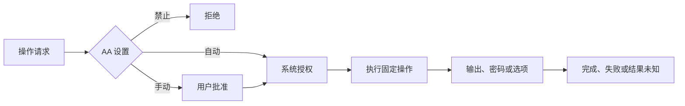

# auto-admin

AutoAdmin（AA）在内置管理操作执行前处理批准，运行中传递密码、选项和终端输入，并接收最终结果。

| 部分 | 职责 |
| --- | --- |
| `auto-admin` | 批准状态、任务输入、停止请求、结果和 Linux 授权连接 |
| Shell | 弹窗、焦点、按钮、屏幕键盘和页面返回 |
| watchdog | 任务创建、panic 记录和线程收尾 |
| platform | 固定系统操作和实际权限检查 |



AA 策略为 `manual`、`automatic` 和 `deny`。自动批准只跳过 AA 确认，系统授权和程序原生问题仍需回答。密码只用于当前输入，不写入日志、参数或配置。

批准、运行、取消和结果同步到统一任务历史，输出逐块归档，秘密输入不归档。页面与助手使用稳定编号，只读查询和预览不登记为修改任务。

Homebrew 操作也使用 AA，brew 以当前 macOS 用户运行，Cask 的系统密码由原生安装程序通过任务终端接收。

## 文档与验证

- [批准、输入与终止流程](docs/workflow.md)
- [授权连接与撤销](../platform/docs/authorization.md)
- [任务历史](../platform/docs/task-history.md)

```sh
cargo test --locked -p auto-admin
```

Shell 的 AA 测试覆盖弹窗、焦点、密码遮罩和外部控制快照，Linux 授权交互在对应测试环境验收。
