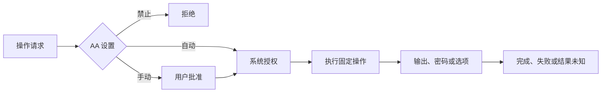

# auto-admin

AutoAdmin（AA）在执行内置管理操作前处理批准，在运行中传递密码、选项和终端输入，并接收最终结果。

| 参与部分 | 负责什么 |
| --- | --- |
| `auto-admin` | 批准后的任务、秘密输入、终端交互、停止请求和 Linux 授权连接 |
| Shell | 弹窗显示、焦点、按钮和返回操作 |
| watchdog | 任务创建、panic 记录和收尾；不决定是否批准 |
| platform | 固定系统操作及实际系统权限检查 |

自动批准只省去 AA 确认，不能替代系统授权或回答程序中的问题。密码不写入日志、参数或配置。写操作不自动重放；连接断开不能被当作执行成功或已回滚。

批准、等待输入、运行、取消收尾和最终结果同步到统一任务历史；输出逐块归档，秘密输入不写入。页面与助手共用稳定编号，断线重连不重复列出同一操作。只读查询和预览不登记成修改任务。

完整的输入、终止、强制结束和权限要求见[操作流程](docs/workflow.md)。

私有连接、sudo 密码缓存隔离和任务控制接口要求见 [platform 授权说明](../platform/docs/authorization.md)。

验证：`cargo test --locked -p auto-admin`，并运行 Shell 的 AA 界面测试和 Linux 授权交互检查。

AA 的界面数据保留当前问题是否为秘密输入的标记，供 Shell 外部控制快照隐藏密码；不改变正常批准和密码输入流程。

macOS Homebrew 操作也遵循 AA 策略，通过任务输入通道处理原生终端和停止请求。brew 本身以当前用户运行，Cask 若需要额外系统授权，由其原生安装程序在终端请求。
