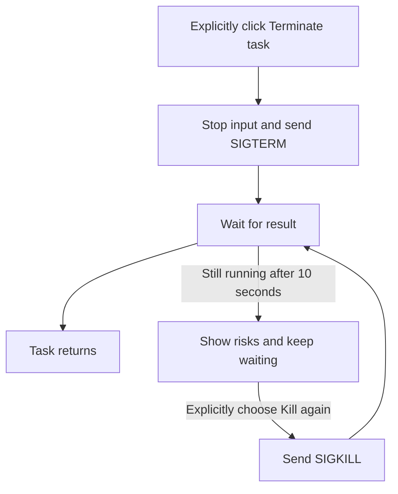

# AutoAdmin approval and interaction

`auto-admin` manages tasks, input, and cleanup; Shell manages dialogs and focus; watchdog supervises threads and panics. See the [README](../README.md) for responsibilities.

## Requests and approval

Settings → System → AutoAdmin saves `auto_admin` in `config.toml`:

| Setting | Behavior |
| --- | --- |
| `manual` (default) | Show the operation, target, and non-password arguments; execute after user approval |
| `automatic` | Skip AA confirmation while retaining system authorization and program prompts |
| `deny` | Reject before starting the system command |
| Unreadable configuration | Reject new requests |

Built-in management operations, account writes, and power operations go through AA; ordinary queries do not require approval. AA does not intercept commands entered by users themselves or system dialogs from external programs.

Manual confirmation initially focuses Approve. Tab/Shift+Tab/Left/Right switch focus, Enter/Space approves, and Reject or Esc closes the dialog. Repeats of the key that opened the dialog cannot approve subsequent prompts in succession; terminals without key-release reports use a 750ms interval to block repeated presses of the same key.

Tasks start only once, and write operations are not replayed automatically. Startup failures or panics clear pending prompts and save a report; an indeterminate outcome is shown as "Outcome unknown".

## Input during execution

| Focus or action | Behavior |
| --- | --- |
| Terminal focus | Send text, Enter, arrow keys, function keys, key combinations, and paste to the task |
| Password input | Keep the screen and external snapshots masked; do not write input to history |
| Numbered backend prompt | Enter the number and press Enter |
| F6 | Switch between the terminal and buttons |
| Button focus | Select with Tab/arrow keys, activate with Enter/Space, and return to the terminal with Esc |
| Shift+PageUp/PageDown, mouse wheel | Browse output history |

Package operations display native y/n, configuration-conflict, and installation-script prompts through a real PTY, while retaining y, n, and Enter buttons. Input is sent only to the current unfinished request.

While a task still belongs to the current page, F12 or the Back button opens a close confirmation with options to continue in the background, cancel and close, or remain on the page. Continuing in the background destroys the page; AA appears automatically when input is needed.

Output is retained after completion, failure, or disconnection. Enter/Space/Esc or Close exits. Management pages can reopen the corresponding output with Ctrl+T.

## Termination and forced termination

SIGTERM requests a normal exit; SIGKILL forces termination. Signals are sent only after an explicit termination action, not on ordinary closing, cancellation, or disconnection.

Linux uses pidfd to retain stable process references and track descendants, preventing actions against the wrong process after PID reuse. The helper waits for the current child process to exit before cleanup; it does not terminate Shell or the entire authorization session.

Tasks that only wait for a shared D-Bus service have no local process that can be terminated independently. They offer cancellation only, with the Kill button disabled. After interruption, query the actual system state before deciding the next step.

## Interface

AA uses a dark blue background, cyan borders, a separate branding panel, and background dimming. Narrow windows hide the left branding panel. Dialogs resize to fit their contents; after completion, blank output space collapses while history remains. Buttons, animations, and focus follow the [UI requirements](../../../docs/UI-requirements.md).
