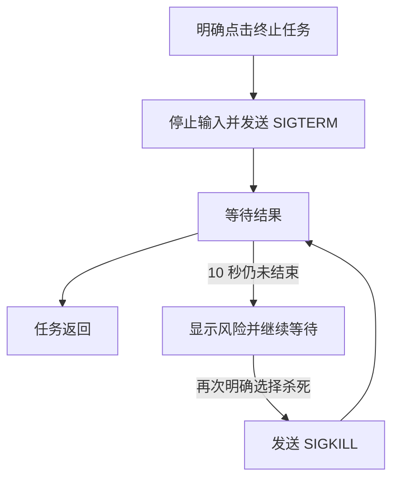

# AutoAdmin 批准与交互

`auto-admin` 管理任务、输入和收尾，Shell 管理弹窗与焦点，watchdog 监督线程和 panic。分工见 [README](../README.md)。

## 请求与批准

“设置 → 系统 → AutoAdmin”保存 `config.toml` 的 `auto_admin`：

| 设置 | 行为 |
| --- | --- |
| `manual`（默认） | 显示操作、目标和非密码参数，用户批准后执行 |
| `automatic` | 跳过 AA 确认，保留系统授权和程序问题 |
| `deny` | 在启动系统命令前拒绝 |
| 配置不可读 | 拒绝新请求 |

内置管理、账户写入和电源操作从 AA 进入，普通查询不需要批准。AA 不拦截用户自己输入的命令或外部程序的系统弹窗。

手动确认默认聚焦“同意”，Tab/Shift+Tab/左右键切换，Enter/空格批准，拒绝或 Esc 关闭。打开弹窗的按键连发不会连续批准后续问题；没有松键报告的终端使用 750ms 间隔拦截同键连发。

任务只启动一次，写操作不自动重放。启动失败或 panic 清除待回答问题并保存报告，无法确定结果时显示“结果未知”。

## 运行中的输入

| 焦点或操作 | 行为 |
| --- | --- |
| 终端焦点 | 文字、回车、方向键、功能键、组合键和粘贴交给任务 |
| 密码输入 | 画面和外部快照保持遮罩，输入不写入历史 |
| 后端编号问题 | 输入编号并按 Enter |
| F6 | 在终端与按钮之间切换 |
| 按钮焦点 | Tab/方向键选择，Enter/空格执行，Esc 返回终端 |
| Shift+PageUp/PageDown、滚轮 | 查看历史输出 |

软件包通过真实 PTY 显示原生 y/n、配置冲突和安装脚本问题，并保留 y、n、Enter 按钮。输入只发送到当前未结束的请求。

任务仍属于当前页面时，F12 或返回按钮打开关闭确认，可继续后台运行、取消并关闭或留在页面。继续后台运行后销毁页面，AA 在需要输入时自动显示。

完成、失败或断线后保留输出，Enter/空格/Esc 或“关闭”退出。管理页面可通过 Ctrl+T 重新打开对应输出。

## 终止与强制结束

SIGTERM 请求正常退出，SIGKILL 强制终止。只有明确的终止操作才发送信号，普通关闭、取消或断线不会触发。

Linux 使用 pidfd 保存稳定进程引用并跟踪后代，避免 PID 复用后操作错误进程。助手等待当前子进程结束后收尾，不结束 Shell 或整个授权会话。

仅等待共享 D-Bus 服务的任务没有可单独终止的本地进程，只提供取消并禁用杀死按钮。中断后先查询真实系统状态，再决定下一步。

## 界面

AA 使用深蓝底、青色边框、分栏标识和背景压暗，窄窗口隐藏左侧标识。弹窗随内容调整尺寸，完成后收起空白输出并保留历史。按钮、动画和焦点遵循 [UI 要求](../../../docs/UI-requirements.md)。
