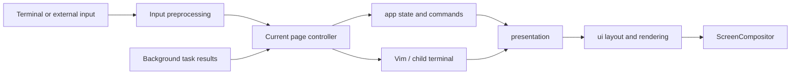

# shell

`shell` provides `tundra-shell`, connecting application state, terminal input, page navigation, background tasks, and Ratatui rendering into a complete session. It determines the current page, return path, focus, and dialogs, and composites the final terminal display.

## Main responsibilities

- Initialize identity, assets, storage, system services, and the terminal, and complete first-time setup and startup.
- Convert Crossterm events into application input and route them according to modal layers, focus, and hit regions.
- Manage independent page instances, opening paths, dialog stacks, close confirmations, and ownership of background tasks.
- Convert `AppSnapshot` and session state into ViewModels, and render pages and global bars through `ui`.
- Host the command line, external programs, Vim, and script workspaces, with process and terminal details supplied by the corresponding runtime crates.
- Provide local external CLI control, converting automation requests into normal input events.

## Module structure

| Location | Responsibility |
| --- | --- |
| `src/startup/` | Startup checks, first-time setup, startup screens, and command-line arguments |
| `src/input/` | Crossterm event batching, input types, and terminal event conversion |
| `src/session/controller/` | Page actions, application commands, task results, and input routing |
| `src/session/presentation/` | Assemble UI ViewModels from application and session state |
| `src/session/compositor/` | Composite pages, title bars, status bars, dialogs, and effects into complete frames |
| `src/session/navigation.rs` | Page opening paths and back navigation |
| `src/session/page_state.rs`, `page_lifecycle.rs` | Page instances, close checks, and resource cleanup |
| `src/session/tasks.rs`, `overlay*.rs` | Task ownership, dialog order, focus, and input interception |
| `src/session/runtime.rs` | Event loop, refresh, and exit cleanup |
| `src/session/automation.rs` | External control requests and snapshot publication |
| `src/previews/` | Previews of shared controls, styles, AA, and the on-screen keyboard |

Controllers are grouped by application, including account, clock, command_line, editor, explorer, launcher, logs, management, settings, and system_status. Shared input preparation, focus, and pointer capture live in `controller/input/`; page-specific operations remain in the corresponding controllers.

## Session flow



Opening a page creates a new `PageInstanceId`. Page data, task results, dialogs, and focus are checked against the instance; covered pages retain their state, while reopening a closed page uses a new instance.

When closing a page with running work, users can continue in the background, cancel and close, or stay on the page. watchdog handles task execution and process supervision; Shell handles the page a task belongs to, cancellation choices, and result presentation.

Logged-in non-guest users can open Tasks from the global title bar and see running or awaiting-approval status. Pressing Tasks again closes the current task page and restores its originating page without creating another instance. Background queries do not count as running operations. First-time setup can finish with the default appearance using F9 after required account validation; appearance remains editable later.

The title and status bars each occupy one row, preserving 18 content rows at the 108 × 20 minimum. The status row holds the keyboard entry before the clock. Shared layouts provide painting, focus, hit testing, and automation coordinates; opening the keyboard keeps the title row and hides the status row.

## Interface hosting

- **Home:** The minimum terminal size is 108×20, shared by startup, runtime resizing, the lockscreen, and Command Line. At that size all Home entries fit on one page as names only; smaller terminals show an error. F2 or the Edit icons button enters edit mode. Pointer drops and Shift+Left/Right save icon order in each user’s `home.order.<user_id>` state entry. Esc cancels a drag first, then finishes editing; focus loss, resizing, overlays, and navigation cancel pending drops.
- **Home and Launcher:** show supported system tasks directly on Home and exclude those entries from Launcher. Home uses plain names; open entries by clicking or selecting with arrows and pressing Enter/Space, without letter shortcuts. Search Launcher by name, path/command, or type, and organize its remaining built-in applications, custom commands, and external programs. Built-in and blank-area context menus expose page actions without permitting edits or deletion of built-in entries.
- **Files:** share copied/cut files across Explorer pages and undo safe moves or renames through the shared application service. First save and Save As keep directory browsing, filename, Save, and Cancel together.
- **Editor and scripts:** keep common editing tools visible, preserve the text selection when opening the standard editor's context menu, manage multi-document pages and Vim, and host script execution and debugging. macOS text editing follows Command and Option conventions.
- **System management and logs:** present platform operations with AA authorization, shared focus and selection controls, and persistent expert areas opened with F3. UX logs keep expert filters and related actions visible while changing rows or filters; F10 still opens the menu.
- **Dialogs:** Shell shades the covered content before drawing the active dialog. The title and status bars keep their own layout. Visible loading labels share the frame timer and stop requesting frames when they settle or are covered.
- **Settings and status:** use Tab to move between regions and controls and arrows within the focused region. Advanced animation timings use one three-column form with a draft and a single save/cancel operation. New Linux profiles use ASCII icons. On a terminal with image support, users can switch to image icons in Settings → Appearance → Theme.
- **Updates:** Linux defaults to Release, showing release notes and download progress. Beta additionally shows compilation progress and live output; Windows source updates retain those build details.
- **Child terminals:** each page has an independent PTY, continues reading output while covered, and cleans up its process tree when closed.

Keyboard, mouse, and touch use the same interruptible transitions. Page, dialog, and menu bodies remain readable at fixed final coordinates from the first frame; details and the keyboard use clipped expansion. The event loop prioritizes immediate input, schedules active UI motion at 60 FPS, retains the separate 30 FPS weather/rainbow policy and 80ms busy cadence, and stops animation deadlines at rest. Slow terminal writes advance from elapsed time without replaying missed frames. Reduced motion renders the final state directly.

Launcher confirmations use the current shared layout to capture button presses and releases before a redraw. Their search field and list remain covered. Explorer popup wheels move the popup selection, and right clicks retain the active popup without changing the covered file list.

See [UI requirements](../../docs/UI-requirements.md) for shared buttons, forms, animations, and layouts. See [Editor and script workspace](../../docs/source-editor.md) for editor operations and [List selection](../../docs/list-selection.md) for page multi-selection.

## External CLI control

After external CLI control is enabled in Settings → System, the same operating-system user can use `tundra-cli ui` to read controls and screen content, or send clicks, drags, scrolling, keys, and text.

`session/automation.rs` sends requests through the normal input flow, and the compositor captures snapshots from actual rendered frames. Real user actions invalidate old snapshots, requiring another `snapshot` or `wait`. Passwords remain masked in exported content. See [CLI control](../cli/docs/ui-control.md) for the protocol and examples.

Already-due wheel steps from one external scroll request share a frame without dropping steps or advancing future events. Clicks and drags retain separate press and release frames.

## Build and validation

```sh
cargo build --locked -p shell -p cli
cargo test --locked -p shell
```

Shell's built-in command line uses `tundra-cli` from the same directory, so build both packages after updates. Real-terminal regressions:

```sh
python3 scripts/tests/shell-control.py target/debug/tundra-shell
python3 scripts/linux-shell-smoke.py target/debug/tundra-shell
```

On macOS, Unix child-terminal tests can use `TMPDIR=/private/tmp cargo test --locked -p shell -p terminal-runtime --lib`.

## Related documentation

- [Sessions, navigation, and rendering](docs/session.md)
- [Debug interface previews](docs/previews.md)
- [UI requirements](../../docs/UI-requirements.md)
- [Built-in applications](../app/docs/applications.md)
- [CLI and Command Line](../cli/docs/commands.md)
- [terminal-runtime](../terminal-runtime/README.md) · [vim-runtime](../vim-runtime/README.md)
