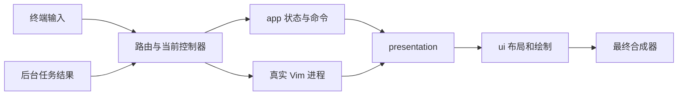

# shell

`shell` 把应用状态、界面、终端输入和后台任务连接起来，提供 `tundra-shell`。它决定当前页面、返回路径、焦点和弹窗，最后合成完整的一帧。

共享 QWERTY 屏幕键盘在小窗口中切换字母区与功能区，宽窗口同时提供功能键、导航键和方向键。区域切换保留 Ctrl、Alt 和 Shift 状态；粘贴按钮单独发送粘贴事件。

命令行、脚本与 Vim 共用 `terminal-runtime::pty::PtyProcess` 的按键、粘贴和鼠标处理。内置 CLI 的参数、主题变量及特殊退出码留在命令行宿主中，通用子终端不解释这些应用专用行为。

Launcher 的“运行设置 F4”可为已批准的外部程序保存嵌入终端、参数和工作目录。每次启动创建独立页面；成功退出返回原 Launcher，失败保留可滚动的输出和退出码，Enter 按原配置重试，F12 返回。运行中的 F12 仍交给子应用，返回按钮确认后清理当前进程树。内置 CLI 专用的退出码 75、76 不用于外部程序。

子终端的增强键盘、焦点、鼠标和粘贴按当前协议发送。三种图片协议先进入共享终端模型，再由合成器按真实内容区显示；原生图像不可用、透明或叠层图片以及弹窗覆盖时使用字符色块，图片缓存随页面释放。

软件包、服务、进程、定时任务和文件管理的“选择多项”提供勾选框与已选数量，保留原快捷键。屏幕键盘覆盖内置文字输入，包括登录、首次设置、账户、设置文字弹窗、普通编辑器与查找替换、文件路径、搜索、新建和重命名；输入继续走原页面的检查和提交。字段切换取消旧按下，页面或弹窗变化清除旧归属。

Linux 启动器的“脚本编辑器”和普通编辑器的“脚本”菜单共用文档页。默认显示源码和输出，变量、调用栈、断点及表达式按需展开；共享操作栏随空闲、运行和调试暂停切换，最多五项。`controller/script.rs` 处理运行设置、保存后启动和断点；`script_host.rs` 连接 `script-runtime`，持续读取输出，并等待进程树清理后完成任务。执行期间源码只读；Vim 先导出文档，再临时显示普通源码，结束后恢复原进程和用户设置。操作和验证见[脚本工作区](../../docs/source-editor.md#linux-脚本工作区)。

脚本结束后只保留终端输出，仍可滚动查看历史；关闭文档时释放。调试器报告的其他源码复用共享文件读取规则，管道、设备和符号链接不会被当成源码打开。

启动器中的“任务”打开统一列表，提供状态筛选、输出、返回页面、取消和手动清理。页面关闭后保留摘要和输出，原页面还在时返回原实例；已关闭时只打开所属功能。任务归档和权限范围见[任务历史](../platform/docs/task-history.md)。定时任务创建、编辑与时间预览放在 `controller/management/scheduled.rs`，配置备份的日期、来源和分页操作放在 `controller/management/backups.rs`。

全部页面无操作后显示 Weathr，默认 5 分钟；“设置 → 系统 → 屏幕超时时间”可选永不、30 秒、1/2/5/10/30 分钟。按键或点按返回原页面，保留输入、弹窗、页面实例及登录状态；唤醒的按键、重复事件和点按松开不会执行页面操作。后台任务与时钟继续运行。未登录时唤醒仍回到登录页，登录页也使用同一超时设置。

页面底部操作栏沿用原有命令、授权和确认。F1 或标题栏帮助按钮打开本页帮助，可用方向键、翻页、滚轮或拖动滚动条阅读，F1、Esc 或关闭按钮返回原焦点。已有弹窗、AA 和屏幕键盘优先处理输入；命令行和 Vim 正文中的 F1 继续交给子终端。

日志查询正常完成时不显示“已就绪”，避免自动刷新时提示行反复出现导致列表和详情框高度变化；读取异常和其他提示仍在页面底部显示。

文件属性的“权限与归属”支持多选，并打开独立管理页，沿用 AA、页面任务和返回规则。权限与递归勾选项可用空格或 Enter 切换，文字字段的空格继续作为文本输入。修改表单退出前确认是否放弃，账户选择支持查找与屏幕键盘。

Explorer 的删除和清空回收站统一由全局确认框处理，页面不再生成第二套确认框；确认和取消仍沿用原有任务与焦点恢复规则。报错时，底部状态栏保存具体原因，改变文件选择后也不会被“文件管理器错误”覆盖；后续操作成功时正常更新提示。

启动器图标模式中，上下键按当前窗口的实际列数切换行，左右键切换相邻项目，选中项自动滚入可见区域；详情模式中，上下键逐行选择。

Linux 时钟直接跟随系统时间和时区，已有配置中的独立时区、HTTP 时间来源不再生效；首次设置由语言直接进入外观。“区域与时间”复用地图选择系统时区，并设置系统自动校时和 timesyncd/chrony 服务器，支持逐项编辑和 F5/按钮刷新，沿用原有授权、检查与备份。后台结果只返回所属设置页。“操作系统设置”只保留主机名。Windows/macOS 演示模式继续使用原有时间选项。

`tundra-shell --help`（`-h`）显示帮助，包含供 agent 使用的 UI automation 介绍、开启方式和 `tundra-cli ui` 控件查看、点击及文字输入示例。`tundra-shell --version`（`-V`）显示版本。这些查询不启动 watchdog、不读写配置，也不进入全屏界面；不带参数时正常启动 UI。

区域与时间读取失败后，自动校时值显示不可用并保留具体失败原因；查询尚未完成时才显示加载中。

用户管理的账户/组视图字段使用独立标签，服务管理仍显示系统/当前用户的作用域；提交字段保持原有契约。

## 分工

| 位置 | 做什么 |
| --- | --- |
| `src/session/controller/` | 按应用分组，处理操作、任务结果和输入路由 |
| `src/session/presentation/` | 把应用状态和会话状态转换成界面需要的数据 |
| `src/session/compositor/` | 按顺序绘制页面、标题栏、状态栏和弹窗 |
| `src/session/navigation.rs`、`page_state.rs`、`page_lifecycle.rs` | 保存独立页面实例，安排打开、覆盖、确认关闭和清理 |
| `src/session/tasks.rs`、`overlay*.rs` | 核对任务结果和弹窗的页面归属，恢复对应焦点 |
| `src/session/runtime.rs` | 事件循环、刷新和退出处理 |
| `src/startup/` | 启动检查、首次设置和启动画面 |
| `src/previews/` | 样式、AA 和屏幕键盘演示 |
| `src/input/` | Crossterm 事件批处理、终端事件转换和 Shell 输入类型 |

`controller/` 按 account、auto_admin、clock、command_line、diagnostics、editor、explorer、help、launcher、logs、management、notifications、settings、system_status 分组。页面专用输入放回对应分组，通常使用 `input.rs`；公共路由、焦点和命中逻辑留在 `controller/input/`。

输入入口统一为 `controller/input/preparation.rs::prepare_input`，运行时和无终端测试共用。`interaction.rs` 保存跨帧的输入方式、悬停抑制、按钮捕获和快捷键重复保护；`pointer.rs` 处理共享按钮的命中与松开确认；`input_routing.rs` 决定事件目标和语义命令。页面控制器只保留其业务操作、文本编辑和专用拖动语义。Crossterm 继续负责底层事件解析，Ratatui 继续作为唯一界面与渲染系统。

管理页搜索、共享管理文字表单、编辑器配置表单和 AA/Command Line 的屏幕键盘按钮统一由合成器放在右下角、时间栏上方。普通页面展开键盘时，标题栏逐渐收成一行，状态和时间栏退场，内容与表单缩到按键上方；粘贴和收起分别放在键盘最底排的左、右端，大小和其他按键一致；收起时恢复。AA 是顶层弹窗，只调整弹窗，保持灰色背景和标题栏布局。所有开合跟随动画速度和减少动态效果配置，绘制、点击及子终端行列数使用同一布局。键盘输入核对页面实例与表单实例，关闭搜索、切换表单或打开其他弹窗后，不会把旧按键送进新的输入框。

已包含完整详情的管理快照只切换详情显示，不重新查询。授权读取后的刷新和搜索沿快照提供的读取动作再次授权，保留当前查询条件、排序与所选记录；读取失败不会自动重复请求授权。

鼠标或触屏打开整页、弹窗和菜单时，边框从入口按钮放大并移动到新界面的边框位置，关闭时缩回同一个入口。页面实例保存入口矩形，后续点击或实体键盘操作不会改写返回位置；窗口尺寸变化后不使用旧坐标。通用右键菜单也遵守同一规则，无按钮入口时从点击位置展开，没有可用入口坐标时从自身中心展开。管理详情仍向左（窄窗口向上）扩展并收拢列表，屏幕键盘仍从底部开合。开合复用 ui 的计时、边框绘制和三段速度曲线，跟随速度及减少动态效果设置；退出被新弹窗接续时保留原时间进度。实体键盘操作直接完成，动画中切回键盘也立即响应。缩放或离开页面时清除旧动画。

动画速度百分比下方的高级选项打开居中弹窗，分别调整页面、弹窗、菜单的三段毫秒时长，并按用户保存。页面与屏幕键盘共用页面时长，详情使用弹窗时长；点击等待和实际绘制使用同一时长。恢复动画默认值同时重置百分比和九项阶段参数，减少动态效果期间也可恢复。

动画共用一份不可修改的基础画面，避免每帧重复复制整屏字符；没有终端图片的画面跳过逐字检查图片覆盖范围，降低系统详情和弹簧进度条持续刷新时的 CPU 开销。展开中的进度内容仍逐帧更新，中文和图片区域继续受到保护。

事件循环每轮只保存一份会话基线，检查重绘时直接借用比较并忽略 tick 与命中区域的刷新计数，避免反复复制整个会话，以及每次绘制刷新命中区域后再次请求绘制。实际命中区域、焦点、页面、提示和应用数据变化仍触发重绘。

软件包页接入共享分栏：已安装、更新、搜索从上到下使用左侧大按钮，默认打开已安装；当前页保留强调色和 `->`，鼠标操作后列表选中条仍显示。主要操作位于详情底部；软件源、检查修复、配置冲突分别归入对应页的高级区。Tab/Shift+Tab 正反向循环切换三个主菜单，↑/↓ 直接选择右侧列表项；F7/F8/F6、F3 和各操作快捷键保留。Enter/F4 展开详情后，↑↓←→ 滚动超出可见范围的内容，Esc/F4 返回列表并保留选中项。切换子页会清除旧列表，等查询返回后显示本页内容。

软件包主列表可点按“选择多项”后逐项勾选，也保留 Shift+点击或 Shift+Enter；方向键只移动当前位置。选择按包编号保存，排序和刷新保留仍存在的包，切换子页或修改查询条件清除多选。安装、卸载和更新只在全部已选包都支持时可用，表单和 AA 保存完整选择并列出包名。其他页面的规则见[列表多选检查](../../docs/list-selection.md)。

服务、进程和计划任务复用 `controller/management/selection.rs` 的逐项多选、按钮限制及完整确认名单，说明放到各自的 F1 帮助。服务可批量启动、停止、重启、重载及启停用；进程可批量暂停、继续、终止及设置同一主线程优先级；计划任务可批量暂停、恢复和立即执行。进程选择同时保存启动身份，cron 选择核对原任务标识，刷新后不把复用的 PID 或同一行的新命令继续当作旧选择。排序保留选择，切换列表和改变筛选清除多选；没有选中项时不会执行针对记录的操作。

macOS 复用同一软件包页管理 Homebrew Formula/Cask，高级区提供刷新元数据。需要确认的操作独立遵循 AA 策略，不要求以 root 运行 brew；原生确认、Cask 密码、窗口尺寸和显式停止通过现有任务输入通道传递。

Windows 同样显示软件包入口，使用 WinGet 查询和执行安装、卸载、更新；写操作继续经过 AA，成功后按当前页面和筛选重新查询。后端没有提供高级操作时隐藏高级入口，F3 不执行其他操作。

切换为鼠标操作时，首页按钮隐藏键盘焦点颜色；启动器的选中项目继续显示强调色。

新建闹钟弹窗可通过取消按钮、Esc，或 Tab 选中取消后按 Enter/空格关闭；鼠标与触摸沿用同一区域按下、松开才执行的规则。

管理结果记录生成时的语言版本。切换语言或重载自定义语言包后，正在显示或重新返回的管理页会等当前操作和表单结束，再沿原读取方式刷新一次；失败不循环请求。同一视图保留排序、筛选和所选记录。

较大的控制器再按实际工作拆分：editor 分为 view/input/settings/files/recovery/tasks；settings 分为 forms/background/view/devices/tasks；management 分为 actions/input/touch/config_editor。入口文件负责连接这些步骤。

终端模式和子终端由 [terminal-runtime](../terminal-runtime/README.md) 管理；批准、密码和任务执行由 [auto-admin](../auto-admin/README.md) 管理。Shell 保留界面控制，不另建任务监督系统。

命令行与脚本输出直接接收可共享的 UI 终端快照，避免保存和复制两份整屏字符。命令行和 Vim 共用有界输入批处理，连续按键与粘贴按原顺序交给子终端，减少逐键重绘。

AA 实时输出右侧提供可拖动滚动条，运行中和结束后均可查看历史；键盘翻页、滚轮和拖动共用同一输出位置。失焦、缩放或键盘输入会取消旧拖动。

设置页最左侧大类由 Tab/Shift+Tab 切换，左右键只在应用列表与所选应用的设置区之间移动焦点，上下键选择当前区域的项目；方向键不保存设置。开关由 Enter/空格或点按切换。数值项由 Enter 或点按打开弹窗，左右键只调整草稿，也可直接输入数字；Enter 或确认按钮保存，Esc 或取消按钮丢弃草稿并恢复原焦点。数值范围沿用原有配置约束。

系统设置中的 AA 与屏幕超时使用选择弹窗。AA 保留“一律禁止／手动批准（默认）／一律放行”，屏幕超时保留原有七档；方向键或点按只改变弹窗中的选择，确认后沿原有权限检查和保存流程生效。

页面内的嵌套弹窗也按栈管理。合成器先绘制下层弹窗并保留其画面，再绘制最上层；开合动画只处理栈顶，关闭数值弹窗或其上的帮助时不会重播原弹窗的进入动画。

编辑器 F8 和 Vim 按钮切换到随包的真实 Vim，首次默认关闭，开关按原配置保存。Vim 启用时，开关及返回按钮的彩虹文字按真实时间持续流动，不受动画速度、减少动态效果或按钮状态控制；仅彩虹文字可见时请求持续刷新。`vim-runtime` 经已有 PTY/ConPTY 运行进程，UI 绘制其原生画面；模式、计数、operator、Visual、寄存器、宏、窗口、搜索、Ex 命令及 `:help` 由 Vim 自己处理。正文中的 Esc、Ctrl+W 等继续交给 Vim，Ctrl+W 操作 Vim 窗口。外层返回按钮发出 Vim 关闭请求，未保存内容按 Vim 规则处理。

F8 或“VIM模式已启用”按钮先同步未保存缓冲，再暂停 Vim 显示并返回普通编辑器，不自动写文件；再次 F8 继续同一进程，保留已有寄存器、宏和撤销记录。普通编辑器里的修改会同步回相应 Vim 缓冲。`:w`、`:wq` 和其他文档写入请求交给现有异步保存任务；只读限制、文件变更检查及系统配置的差异、验证和授权继续由宿主处理。只有保存成功才确认写入，失败时保留修改，`:wq` 不退出；`:q!`、`:qa!` 遵循 Vim 的放弃规则。

Vim 后台同步当前文档时不重复切换页面，保留按钮从按下到松开的状态；实际切换到其他文档时仍取消旧点击。

发布包提供 Shell 同目录的 `vim/vim[.exe]`、`vim/runtime/`、许可证和固定来源信息。缺少随包及用户目录引擎时，开启 Vim 会打开安装弹窗，从项目 Release 下载预编译引擎，显示进度并支持取消；成功后自动进入 Vim，失败则保留普通编辑器。`vim_host/install.rs` 管理后台任务及页面归属。开发时仍可运行 `python3 scripts/build-vim.py --output target/debug/vim`。`TUNDRA_VIM` 可覆盖可执行文件路径，指定路径无效时仍报错；`TUNDRA_VIM_CLEAN=1` 用于隔离个人配置和插件。普通运行按 Vim 的方式加载用户配置。构建依赖和三平台打包见[随包 Vim](../../docs/packaging/vim.md)，使用细节见[编辑器说明](../../docs/source-editor.md#真实-vim-模式)。

恢复光标加速默认设置不会改变 Vim 开关。

运行中窗口小于布局下限时显示尺寸提示并暂停页面输入，保留编辑缓冲、弹窗和计时状态；恢复尺寸后继续。绘制前核对实际终端尺寸，避免输入检查使用旧尺寸。编辑器保存完成同步更新状态及相关文件列表。文件名输入复用共享选区控件，首次设置和管理表单提供 F10 完成，管理搜索明确提示 Enter 提交。

## 阅读入口

- [会话、导航与绘制](docs/session.md)：启动、输入、焦点、页面返回和异常处理。
- [调试预览](docs/previews.md)：屏幕键盘、AA 输入演示及样式预览。
- [统一 UI 要求](../../docs/UI-requirements.md)：所有页面必须遵守的交互规则。
- [内置应用](../app/docs/applications.md)、[CLI 与 Command Line](../cli/docs/commands.md)。

构建时同时执行 `cargo build --locked -p shell -p cli`，否则内嵌命令行可能继续使用旧 CLI。验证使用 `cargo test --locked -p shell`；终端输入和模式恢复还需对应系统的真实 PTY 检查。

固定测试优先覆盖完整操作、页面与任务归属、保存恢复、授权和退出收尾；输入转换与基础样式由共享层验证，不在会话中重复检查事件标签、颜色和动画绘制细节。

真实 Vim 脚本回归同时检查跨文档切换和同一文档调试结束后的编辑权限，并实际执行普通 `:write`，避免只检查桥接状态而遗漏 Vim 原生只读选项。

macOS 可用 `TMPDIR=/private/tmp cargo test --locked -p shell -p terminal-runtime --lib` 验证子终端输入与后台任务清理，避免 `/var` 的符号链接被路径安全检查拒绝；按键字节测试统一系统 `od` 的空格格式。

`src/previews/ui_test.rs` 提供无状态的 `debug ui-test` 入口：使用内置主题和英文，不读写配置、资源文件或日志；输入及终端恢复沿用现有组件和 `TerminalGuard`。六页控件清单见[调试预览](docs/previews.md#全部共享控件)。

`debug test-rainbow-text` 使用同样的独立预览方式，持续展示彩虹变色文本；Esc、Ctrl+C、Enter 或退出按钮结束。它与控件预览共用鼠标按下/松开处理，关闭或发生绘制错误时由 `TerminalGuard` 恢复终端。

设置页复用软件包管理器的分类侧栏，右侧直接展示设置项，移除额外详情区。高级动画弹窗支持滚动、恢复默认和关闭；各阶段时长通过上层数值弹窗确认后按用户保存。Esc 逐层关闭弹窗，分类和原设置项保持不变。

文件管理器和编辑器合并到“应用设置”：左侧选择应用，右侧显示对应选项。列表用上下键选择，Enter/右键进入设置，Home 返回应用列表；鼠标与触摸直接选择。切换应用不保存配置，恢复默认只修改当前应用。

编辑器默认文件后缀为 106 项，包含全部已有语法着色支持的后缀。默认 `.rs` 文件从 Explorer 直接进入编辑器；后缀列表仍可在应用设置中修改。

系统时区模式下，文件列表和文件属性中的本地日期也跟随系统时区；用户选择 UTC 显示时仍使用 UTC。

## 外部 CLI 控制

在“设置 → 系统”开启“允许外部 CLI 控制”后，同一操作系统用户可以用 `tundra-cli ui` 读取运行中的界面树和逐行画面，或模拟点击、拖动、滚动、按键和粘贴。开关默认关闭、保存到配置，在设置中修改立即生效；启动前可用 `tundra-cli config set automation.enabled true` 预先开启。

`session/automation.rs` 安排真实输入事件并等待绘制完成；`compositor` 从同一帧采集界面信息。外部输入沿用现有输入准备、页面分发、子终端及授权流程。内置密码从导出文字中隐藏，密码所在页面的转场期间暂不导出文字，避免动画中保留的旧帧泄漏内容。独立天气锁屏也使用同一个控制连接。用法见 [CLI 控制](../cli/docs/ui-control.md)。

`tundra-cli ui wake` 沿用天气画面的唤醒输入，关闭空闲天气或天气锁屏后等待 Shell 绘制再回复。普通页面不发送按键，只返回当前画面；不会跳过登录或触发原页面操作。

运行时先读取真实终端输入，再处理外部请求。读取过控件后，真实按键、点击、拖动、滚轮、粘贴或窗口缩放会使旧信息失效，并取消尚未完成的外部手势；`snapshot` 和 `wait` 重新获取后恢复控制。`--snapshot` 同样只按用户操作判断旧编号，自动重绘不影响使用。单纯移动鼠标、动画、进度条、时钟等自动变化及天气画面不参与这项检查。

Linux 实际终端验证：`python3 scripts/tests/shell-control.py target/debug/tundra-shell`（从项目根目录运行）。包含设置 30 秒超时、保留帮助弹窗的键盘唤醒，以及命令行后台运行时的点按唤醒。
