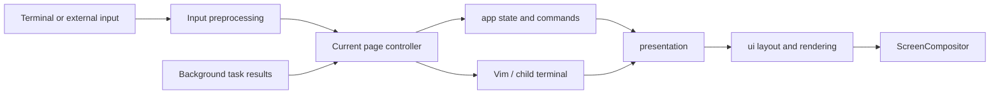

# shell

`shell` provides `tundra-shell`, connecting application state, terminal input, page navigation, background tasks, and Ratatui rendering into a complete session. It determines the current page, return path, focus, and dialogs, and composites the final terminal display.

## Main responsibilities

- Initialize identity, assets, storage, system services, and the terminal, and complete first-time setup and startup.
- Convert Crossterm events into application input and route them according to modal layers, focus, and hit regions.
- Manage independent page instances, opening paths, dialog stacks, close confirmations, and ownership of background tasks.
- Convert `AppSnapshot` and session state into ViewModels, and render pages and global bars through `ui`.
- Host the command line, external programs, Vim, and script workspaces, with process and terminal details supplied by the corresponding runtime crates.
- Provide local external CLI control, converting automation requests into normal input events.

## Module structure

| Location | Responsibility |
| --- | --- |
| `src/startup/` | Startup checks, first-time setup, startup screens, and command-line arguments |
| `src/input/` | Crossterm event batching, input types, and terminal event conversion |
| `src/session/controller/` | Page actions, application commands, task results, and input routing |
| `src/session/presentation/` | Assemble UI ViewModels from application and session state |
| `src/session/compositor/` | Composite pages, title bars, status bars, dialogs, and effects into complete frames |
| `src/session/navigation.rs` | Page opening paths and back navigation |
| `src/session/page_state.rs`, `page_lifecycle.rs` | Page instances, close checks, and resource cleanup |
| `src/session/tasks.rs`, `overlay*.rs` | Task ownership, dialog order, focus, and input interception |
| `src/session/runtime.rs` | Event loop, refresh, and exit cleanup |
| `src/session/automation.rs` | External control requests and snapshot publication |
| `src/previews/` | Previews of shared controls, styles, AA, and the on-screen keyboard |

Controllers are grouped by application, including account, clock, command_line, editor, explorer, launcher, logs, management, settings, and system_status. Shared input preparation, focus, and pointer capture live in `controller/input/`; page-specific operations remain in the corresponding controllers.

## Session flow



Opening a page creates a new `PageInstanceId`. Page data, task results, dialogs, and focus are checked against the instance; covered pages retain their state, while reopening a closed page uses a new instance.

When closing a page with running work, users can continue in the background, cancel and close, or stay on the page. watchdog handles task execution and process supervision; Shell handles the page a task belongs to, cancellation choices, and result presentation.

## Interface hosting

- **Launcher:** organize built-in applications, custom commands, and external programs, and provide run settings, a task list, and exit options.
- **Editor and scripts:** manage multi-document pages, switching between the standard editor and Vim, and script execution and debugging.
- **System management:** present package, service, process, network, disk, and configuration interfaces provided by platform, with operations authorized through AA.
- **Settings and status:** manage appearance, language, the on-screen keyboard, dashboard, clock, weather, and system settings.
- **Child terminals:** each page has an independent PTY, continues reading output while covered, and cleans up its process tree when closed.

See [UI requirements](../../docs/UI-requirements.md) for shared buttons, forms, animations, and layouts. See [Editor and script workspace](../../docs/source-editor.md) for editor operations and [List selection](../../docs/list-selection.md) for page multi-selection.

## External CLI control

After external CLI control is enabled in Settings → System, the same operating-system user can use `tundra-cli ui` to read controls and screen content, or send clicks, drags, scrolling, keys, and text.

`session/automation.rs` sends requests through the normal input flow, and the compositor captures snapshots from actual rendered frames. Real user actions invalidate old snapshots, requiring another `snapshot` or `wait`. Passwords remain masked in exported content. See [CLI control](../cli/docs/ui-control.md) for the protocol and examples.

## Build and validation

```sh
cargo build --locked -p shell -p cli
cargo test --locked -p shell
```

Shell's built-in command line uses `tundra-cli` from the same directory, so build both packages after updates. Real-terminal regressions:

```sh
python3 scripts/tests/shell-control.py target/debug/tundra-shell
python3 scripts/linux-shell-smoke.py target/debug/tundra-shell
```

On macOS, Unix child-terminal tests can use `TMPDIR=/private/tmp cargo test --locked -p shell -p terminal-runtime --lib`.

## Related documentation

- [Sessions, navigation, and rendering](docs/session.md)
- [Debug interface previews](docs/previews.md)
- [UI requirements](../../docs/UI-requirements.md)
- [Built-in applications](../app/docs/applications.md)
- [CLI and Command Line](../cli/docs/commands.md)
- [terminal-runtime](../terminal-runtime/README.md) · [vim-runtime](../vim-runtime/README.md)
