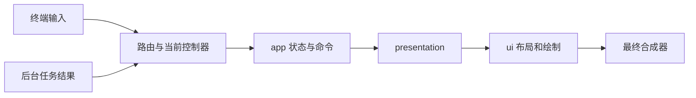

# shell

`shell` 把应用状态、界面、终端输入和后台任务连接起来，提供 `tundra-shell`。它决定当前页面、返回路径、焦点和弹窗，最后合成完整的一帧。

文件属性的“权限与归属”支持多选，并打开独立管理页，沿用 AA、页面任务和返回规则。修改表单退出前确认是否放弃，账户选择支持查找与屏幕键盘。

设置内区分 Tundra 选项与 Linux 操作系统设置。主机名、时区、自动校时和服务器配置沿用管理页的授权、任务和返回规则，不改 Tundra 自己的显示时区和时间来源。

`tundra-shell --help`（`-h`）显示帮助，`tundra-shell --version`（`-V`）显示版本。这些查询不启动 watchdog、不读写配置，也不进入全屏界面；不带参数时正常启动 UI。

## 分工

| 位置 | 做什么 |
| --- | --- |
| `src/session/controller/` | 按应用分组，处理操作、任务结果和输入路由 |
| `src/session/presentation/` | 把应用状态和会话状态转换成界面需要的数据 |
| `src/session/compositor/` | 按顺序绘制页面、标题栏、状态栏和弹窗 |
| `src/session/navigation.rs`、`page_state.rs`、`page_lifecycle.rs` | 保存独立页面实例，安排打开、覆盖、确认关闭和清理 |
| `src/session/tasks.rs`、`overlay*.rs` | 核对任务结果和弹窗的页面归属，恢复对应焦点 |
| `src/session/runtime.rs` | 事件循环、刷新和退出处理 |
| `src/startup/` | 启动检查、首次设置和启动画面 |
| `src/previews/` | 样式、AA 和屏幕键盘演示 |
| `src/input/` | Crossterm 事件批处理、终端事件转换和 Shell 输入类型 |

`controller/` 按 account、auto_admin、clock、command_line、diagnostics、editor、explorer、launcher、logs、management、notifications、settings、system_status 分组。页面专用输入放回对应分组，通常使用 `input.rs`；公共路由、焦点和命中逻辑留在 `controller/input/`。

输入入口统一为 `controller/input/preparation.rs::prepare_input`，运行时和无终端测试共用。`interaction.rs` 保存跨帧的输入方式、悬停抑制、按钮捕获和快捷键重复保护；`pointer.rs` 处理共享按钮的命中与松开确认；`input_routing.rs` 决定事件目标和语义命令。页面控制器只保留其业务操作、文本编辑和专用拖动语义。Crossterm 继续负责底层事件解析，Ratatui 继续作为唯一界面与渲染系统。

管理页搜索、共享管理文字表单、编辑器配置表单和 AA/Command Line 的屏幕键盘按钮统一由合成器放在右下角、时间栏上方。普通页面展开键盘时，标题栏逐渐收成一行，状态和时间栏退场，内容与表单缩到按键上方，底部保留粘贴和收起按钮；收起时恢复。AA 是顶层弹窗，只调整弹窗，保持灰色背景和标题栏布局。所有开合跟随动画速度和减少动态效果配置，绘制、点击及子终端行列数使用同一布局。键盘输入核对页面实例与表单实例，关闭搜索、切换表单或打开其他弹窗后，不会把旧按键送进新的输入框。

已包含完整详情的管理快照只切换详情显示，不重新查询。授权读取后的刷新和搜索沿快照提供的读取动作再次授权，保留当前查询条件、排序与所选记录；读取失败不会自动重复请求授权。

管理结果记录生成时的语言版本。切换语言或重载自定义语言包后，正在显示或重新返回的管理页会等当前操作和表单结束，再沿原读取方式刷新一次；失败不循环请求。同一视图保留排序、筛选和所选记录。

较大的控制器再按实际工作拆分：editor 分为 view/input/settings/files/recovery/tasks；settings 分为 forms/background/view/devices/tasks；management 分为 actions/input/touch/config_editor。入口文件负责连接这些步骤。

终端模式和子终端由 [terminal-runtime](../terminal-runtime/README.md) 管理；批准、密码和任务执行由 [auto-admin](../auto-admin/README.md) 管理。Shell 保留界面控制，不另建任务监督系统。

## 阅读入口

- [会话、导航与绘制](docs/session.md)：启动、输入、焦点、页面返回和异常处理。
- [调试预览](docs/previews.md)：屏幕键盘、AA 输入演示及样式预览。
- [统一 UI 要求](../../docs/UI-requirements.md)：所有页面必须遵守的交互规则。
- [内置应用](../app/docs/applications.md)、[CLI 与 Command Line](../cli/docs/commands.md)。

构建时同时执行 `cargo build --locked -p shell -p cli`，否则内嵌命令行可能继续使用旧 CLI。验证使用 `cargo test --locked -p shell`；终端输入和模式恢复还需对应系统的真实 PTY 检查。
