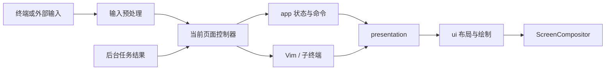

# shell

`shell` 提供 `tundra-shell`，把应用状态、终端输入、页面导航、后台任务和 Ratatui 绘制连接成完整会话。它决定当前页面、返回路径、焦点和弹窗，并合成最终终端画面。

## 主要职责

- 初始化身份、资源、存储、系统服务和终端，完成首次设置与启动流程。
- 将 Crossterm 事件转换为应用输入，按模态层级、焦点和命中区域分发。
- 管理独立页面实例、打开路径、弹窗栈、关闭确认和后台任务归属。
- 将 `AppSnapshot` 与会话状态转换为 ViewModel，通过 `ui` 绘制页面和全局栏。
- 承载命令行、外部程序、Vim 和脚本工作区，进程与终端细节由对应 runtime crate 提供。
- 提供本机外部 CLI 控制，将自动化请求转换为正常输入事件。

## 模块结构

| 位置 | 职责 |
| --- | --- |
| `src/startup/` | 启动检查、首次设置、启动画面和命令行参数 |
| `src/input/` | Crossterm 事件批处理、输入类型和终端事件转换 |
| `src/session/controller/` | 页面操作、业务命令、任务结果和输入路由 |
| `src/session/presentation/` | 把应用与会话状态组装成界面 ViewModel |
| `src/session/compositor/` | 页面、标题栏、状态栏、弹窗和效果的整帧合成 |
| `src/session/navigation.rs` | 页面打开路径与返回 |
| `src/session/page_state.rs`、`page_lifecycle.rs` | 页面实例、关闭检查和资源清理 |
| `src/session/tasks.rs`、`overlay*.rs` | 任务归属、弹窗顺序、焦点和输入拦截 |
| `src/session/runtime.rs` | 事件循环、刷新和退出收尾 |
| `src/session/automation.rs` | 外部控制请求与快照发布 |
| `src/previews/` | 共享控件、样式、AA 和屏幕键盘预览 |

控制器按 account、clock、command_line、editor、explorer、launcher、logs、management、settings、system_status 等应用分组。公共输入准备、焦点和指针捕获位于 `controller/input/`，页面专用操作留在对应控制器。

## 会话流程



每次打开页面都会创建新的 `PageInstanceId`。页面数据、任务结果、弹窗和焦点都按实例核对；被覆盖的页面保留状态，关闭后重新打开则使用新实例。

运行中的页面关闭时可继续后台运行、取消并关闭或留在页面。watchdog 负责任务执行与进程监督，Shell 负责任务所属页面、取消选择和结果展示。

## 界面宿主

- **Launcher：**组织内置应用、自定义命令和外部程序，提供运行设置、任务列表和退出选项。
- **编辑器与脚本：**管理多文档页面、普通编辑器与 Vim 切换、脚本运行和调试。
- **系统管理：**展示 platform 提供的软件包、服务、进程、网络、磁盘和配置接口，操作通过 AA 授权。
- **设置与状态：**管理外观、语言、屏幕键盘、仪表盘、时钟、天气和系统设置。
- **子终端：**每个页面拥有独立 PTY，覆盖时继续读取输出，关闭时清理对应进程树。

通用按钮、表单、动画和布局见 [UI 要求](../../docs/UI-requirements.md)。编辑器操作见[编辑器与脚本工作区](../../docs/source-editor.md)，页面多选见[列表多选](../../docs/list-selection.md)。

## 外部 CLI 控制

在“设置 → 系统”开启外部 CLI 控制后，同一操作系统用户可通过 `tundra-cli ui` 读取控件和画面，或发送点击、拖动、滚动、按键和文字。

`session/automation.rs` 将请求送入正常输入流程，合成器从实际绘制帧采集快照。真实用户操作会使旧快照失效，需要重新执行 `snapshot` 或 `wait`。密码在导出内容中保持遮罩。协议与示例见 [CLI 控制](../cli/docs/ui-control.md)。

## 构建与验证

```sh
cargo build --locked -p shell -p cli
cargo test --locked -p shell
```

Shell 的内置命令行使用同目录的 `tundra-cli`，更新后应同时构建两个包。真实终端回归：

```sh
python3 scripts/tests/shell-control.py target/debug/tundra-shell
python3 scripts/linux-shell-smoke.py target/debug/tundra-shell
```

macOS 的 Unix 子终端测试可使用 `TMPDIR=/private/tmp cargo test --locked -p shell -p terminal-runtime --lib`。

## 相关文档

- [会话、导航与绘制](docs/session.md)
- [调试界面预览](docs/previews.md)
- [UI 要求](../../docs/UI-requirements.md)
- [内置应用](../app/docs/applications.md)
- [CLI 与 Command Line](../cli/docs/commands.md)
- [terminal-runtime](../terminal-runtime/README.md) · [vim-runtime](../vim-runtime/README.md)
