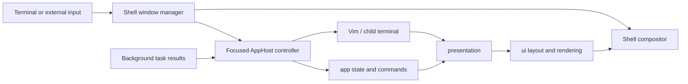

# shell

`shell` provides `tundra-shell`, the terminal workspace, its independent application hosts, and shared session services. The initial process keeps control of terminal recovery and starts the Shell, SessionServices, and AppHost workers. The Shell worker reads and draws the interactive terminal. On Windows the watchdog launches external graphical applications through the OS.

## Main responsibilities

- Initialize identity, assets, storage, system services, and the terminal, and complete first-time setup and startup.
- The Shell manages global input, window layout and focus, and the terminal display.
- Each AppHost runs an application's page controllers, navigation, task ownership, and off-screen rendering. Editors and terminals own their child processes.
- Session services share configuration, the active profile, system status, and file operation state across windows.
- Shared services check the profile revision and save appearance and dashboard changes before publishing them. A draft from an older revision leaves the account file intact.
- The watchdog supervises the Shell and AppHosts independently and can terminate an unresponsive window and its child processes.
- Provide local external CLI control, converting automation requests into normal input events.

## Module structure

| Location | Responsibility |
| --- | --- |
| `src/startup/` | Startup checks, first-time setup, startup screens, and command-line arguments |
| `src/input/` | Crossterm event batching, input types, and terminal event conversion |
| `src/session/controller/` | Page actions, application commands, task results, and input routing |
| `src/session/presentation/` | Assemble UI ViewModels from application and session state |
| `src/session/compositor/` | Render application content and compose the Shell's final frames |
| `src/session/app_host.rs`, `workspace/` | AppHost event loop and Shell-side window management |
| `src/session_services/` | Shared session configuration, profile, system status, and file operations |
| `src/process_host/` | Watchdog process startup, IPC, and terminal recovery |
| `src/session/navigation.rs` | Page opening paths and back navigation |
| `src/session/page_state.rs`, `page_lifecycle.rs` | Page instances, close checks, and resource cleanup |
| `src/session/tasks.rs`, `overlay*.rs` | Task ownership, dialog order, focus, and input interception |
| `src/session/runtime.rs` | Event loop, refresh, and exit cleanup |
| `src/session/automation.rs` | External control requests and snapshot publication |
| `src/previews/` | Previews of shared controls, styles, AA, and the on-screen keyboard |

Controllers are grouped by application, including account, clock, command_line, editor, explorer, launcher, logs, management, settings, and system_status. Shared input preparation, focus, and pointer capture live in `controller/input/`; page-specific operations remain in the corresponding controllers.

## Session flow



Opening an application creates an AppHost and a window. Opening a subpage within an application creates a new `PageInstanceId`. Covered pages retain their state, and task results are checked against their owner.

When closing a page with running work, users can continue in the background, cancel and close, or stay on the page. watchdog handles task execution and process supervision; Shell handles the page a task belongs to, cancellation choices, and result presentation.

Logged-in non-guest users can open Tasks from the global title bar. Background queries do not count as running operations. First-time setup can finish with the default appearance using F9 after required account validation.

## Windows

Every app has a frame with its title and **Minimize**, **Full screen** or **Restore**, **Split**, and **Close** controls. Click a title in the bottom bar to focus or restore that window. Click its minus button to close it normally. A minimized window returns to its previous position when the split has room. When the split is full, restoring it uses the focused slot.

**Split** opens a menu beside the window. Choose side by side, stacked, or grid, then choose a background window or **Add window** to open another app from Home. The side-by-side and stacked layouts fit two windows. Grid adjusts to the available cells. A regular app launch uses the focused slot and moves the previous app to the background.

| After Ctrl+B | Action |
| --- | --- |
| B | Move the focused window to the background |
| W | Open the advanced window list and process controls |
| L | Cycle the layout |
| Z | Maximize the focused window or restore its split |
| Arrow keys | Focus a neighboring window |
| Q | Close the focused window |
| Shift+X | Force kill the focused window |
| Ctrl+B again | Send one Ctrl+B to the focused application |

Esc first dismisses an active dialog or menu. On an ordinary application page, it moves the window to the background. Vim and embedded terminal input handle their own Esc. The global Back control can return from a subpage.

Closing a window prompts for unsaved changes or running tasks. If cleanup still runs after two seconds, the Shell offers **Keep waiting** and **Force kill**. A force kill goes directly to the watchdog.

The terminal minimum is 108 × 20 cells. The global title and bottom bars each occupy one row, and a window frame reserves one cell on each edge. Built-in app content can use the remaining 106 × 16 cells. Resizing temporarily hides windows that no longer fit. A minimized window stays in the bottom bar until restored. When a running app's minimum exceeds the terminal size, window controls remain available and app content is paused. Enlarge the terminal if a normal close needs to display a save or task confirmation.

Embedded terminals can raise their window minimum while running. The workspace uses the largest reported dimensions across all live windows, including the background. A window leaves this calculation when the watchdog confirms it has exited.

The watchdog detects missing Shell progress in five seconds and ends the run with terminal recovery. AppHost failures leave other windows usable. The watchdog can list or stop a session even when external UI control is disabled. [Watchdog commands](../cli/docs/commands.md)

The compositor dims the covered interface beneath modal layers. Dialogs share the OpenCode-inspired header, body, close control, and action-band layout from `ui`; existing notification cancel actions keep their original IDs and routing. The default surfaces retain the v1.5.1 Glacier Night blue palette.

Floating toasts preserve keyboard focus and block pointer input in the area they cover until they disappear. External control reports targets with covered click points as unavailable during that time.

## Interface hosting

- **Home:** The minimum terminal size is 108×20, shared by startup, runtime resizing, the lockscreen, and Command Line. Supported Home entries fit on one page, using name-only tiles when icons would force scrolling; smaller terminals show an error. Larger windows center the title, account, and grid while keeping the action footer at the bottom. F2 or the Edit icons button enters edit mode. Pointer drops and Shift+Left/Right save icon order in each user’s `home.order.<user_id>` state entry. Esc cancels a drag first, then finishes editing; focus loss, resizing, overlays, and navigation cancel pending drops.
- **Home and Launcher:** show supported system tasks directly on Home and exclude those entries from Launcher. Home uses plain names; open entries by clicking or selecting with arrows and pressing Enter/Space, without letter shortcuts. Search Launcher by name, path/command, or type, and organize its remaining built-in applications, custom commands, and external programs. Built-in and blank-area context menus expose page actions without permitting edits or deletion of built-in entries.
- **Files:** share copied/cut files across Explorer pages and undo safe moves or renames through the shared application service. First save and Save As keep directory browsing, filename, Save, and Cancel together.
- **Editor and scripts:** keep common editing tools visible, preserve the text selection when opening the standard editor's context menu, manage multi-document pages and Vim, and host script execution and debugging. F8 switches Vim mode for the current editor window. New editor windows start with the configured default. macOS text editing follows Command and Option conventions.
- **System management and logs:** present platform operations with AA authorization, shared focus and selection controls, and persistent expert areas opened with F3. UX logs keep expert filters and related actions visible while changing rows or filters; F10 still opens the menu.
- **Settings and status:** use Tab to move between regions and controls and arrows within the focused region. Advanced animation timings use one three-column form with a draft and a single save/cancel operation. New Linux profiles use ASCII icons. On a terminal with image support, users can switch to image icons in Settings → Appearance → Theme.
- **Updates:** Linux defaults to Release, showing release notes and download progress. Beta additionally shows compilation progress and live output; Windows source updates retain those build details.
- **Child terminals:** each page has an independent PTY, continues reading output while covered, and cleans up its process tree when closed. Shell renders Kitty, Sixel, and iTerm2 placements from app hosts and retires image resources as panes move or become covered.
- **Clock:** clock windows share the signed-in user's alarms and countdowns and use the same synchronized time as the status bar. Shell advances reminders and presents each one. Concurrent edits check the persisted revision before saving so a stale window cannot replace newer entries.

Keyboard, mouse, and touch use the same interruptible transitions. Page, dialog, and menu bodies remain readable at fixed final coordinates from the first frame; details and the keyboard use clipped expansion. The event loop prioritizes immediate input, schedules active UI motion at 60 FPS, retains the separate 30 FPS weather/rainbow policy and 80ms busy cadence, and stops animation deadlines at rest. Slow terminal writes advance from elapsed time without replaying missed frames. Reduced motion renders the final state directly.

Launcher confirmations use the current shared layout to capture button presses and releases before a redraw. Their search field and list remain covered. Explorer popup wheels move the popup selection, and right clicks retain the active popup without changing the covered file list.

See [UI requirements](../../docs/UI-requirements.md) for shared buttons, forms, animations, and layouts. See [Editor and script workspace](../../docs/source-editor.md) for editor operations and [List selection](../../docs/list-selection.md) for page multi-selection.

## External CLI control

After external CLI control is enabled in Settings → System, the same operating-system user can use `tundra-cli ui` to read controls and screen content, or send clicks, drags, scrolling, keys, and text.

`session/automation.rs` sends requests through the normal input flow, and the compositor captures snapshots from actual rendered frames. The focused window retains its `page/` control IDs. Other visible windows use `session/<id>/` prefixes. Real user actions invalidate old snapshots, requiring another `snapshot` or `wait`. Passwords remain masked in exported content. See [CLI control](../cli/docs/ui-control.md) for the protocol and examples.

Already-due wheel steps from one external scroll request share a frame without dropping steps or advancing future events. Clicks and drags retain separate press and release frames.

## Build and validation

```sh
cargo build --locked -p shell -p cli
cargo test --locked -p shell
```

Shell's built-in command line uses `tundra-cli` from the same directory, so build both packages after updates. Real-terminal regressions:

```sh
python3 scripts/tests/shell-control.py target/debug/tundra-shell
python3 scripts/tests/shell-watchdog.py target/debug/tundra-shell
python3 scripts/linux-shell-smoke.py target/debug/tundra-shell
```

On macOS, Unix child-terminal tests can use `TMPDIR=/private/tmp cargo test --locked -p shell -p terminal-runtime --lib`.

## Related documentation

- [Sessions, navigation, and rendering](docs/session.md)
- [Debug interface previews](docs/previews.md)
- [UI requirements](../../docs/UI-requirements.md)
- [Built-in applications](../app/docs/applications.md)
- [CLI and Command Line](../cli/docs/commands.md)
- [terminal-runtime](../terminal-runtime/README.md) · [vim-runtime](../vim-runtime/README.md)
