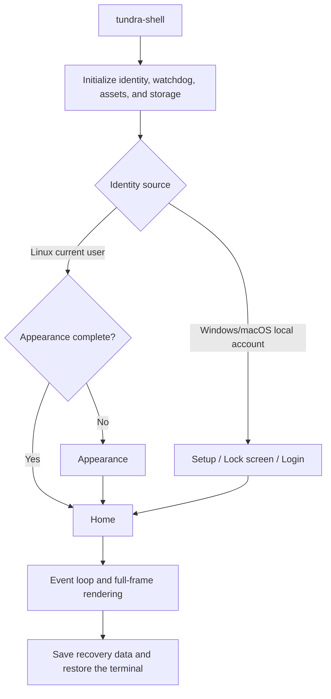
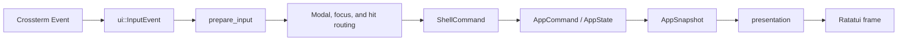

# Shell sessions, navigation, and rendering

This document describes startup, input, page lifecycles, and full-frame compositing in `tundra-shell`. See [UI requirements](../../../docs/UI-requirements.md) for shared visual and interaction rules.

## Startup sequence

1. On Linux, validate real/effective UID and GID, require interactive confirmation when starting as root, then resolve the current user through NSS.
2. Start the independent watchdog. It captures the terminal state, launches SessionServices, and hands the terminal to the Shell worker.
3. Load default assets and calculate the minimum terminal size.
4. `prepare_shell_startup` initializes platform permissions, storage, migrations, and recovery information.
5. Show the startup screen and prefetch weather as needed.
6. On Linux, enter Appearance or Home according to the setup-complete marker for the current UID; on Windows/macOS, enter local account setup, the lock screen, or login.
7. Initialize the Shell's login and Home state. Opening an application launches a separate AppHost whose `ShellSession` owns the business controllers, navigation, and task state.
8. AppHosts render window-local frames. The Shell routes input to the selected window and paints those frames with global controls.

`tundra-shell --help` and `--version` only print query results; they do not enter a full-screen session.

First-time setup offers F9 to use the default appearance and start once required account information is valid. Appearance can be changed later; the application administrator role does not grant operating-system privileges.

Watchdog commands, application data, and shared service requests use separate local connections. Workers verify the peer process identity. Window IDs identify an opening within one run, and layout generations bind input and returned frames to the current viewport.

## Input and event loop

`src/input/` normalizes Crossterm events into `ui::InputEvent`. Keyboard input preserves Press, Repeat, Release, and modifiers; mouse input preserves movement, presses, releases, drags, and scrolling. Paste, focus, and window size are also handled.

Input passes through the following stages:

- `controller/input/preparation.rs` unifies the preprocessing path for real events and tests.
- `interaction.rs` stores the input method, pointer position, button capture, and shortcut repeat protection.
- `pointer.rs` checks the page instance, overlay, and layout region to ensure that a press and release belong to the same target.
- The hit hierarchy is `AppContent < AppOverlay < ShellChrome < ShellModal`; input consumed by an upper layer does not reach the background.
- The main loop handles at most 4,096 events per batch, coalescing consecutive mouse moves and resize events; background results are processed in Tick through `mpsc`.
- Background threads do not directly modify focus, hit tables, or Ratatui frames.

Unix input messages are assembled by the local Crossterm patch. A standalone Esc waits at most 50ms; ordinary messages use a 250ms idle timeout and a 4,096-byte limit; bracketed paste uses a 5-second timeout and a 1 MiB limit. Error logs record only the type and byte count, not raw input.

## Page instances and background tasks

`ShellSession { app, ui }` holds one AppHost's page instances. `PageInstanceId` identifies a page within that opening. `page_state.rs` and `AppPageModels` store its data, selection, scrolling, forms, dialogs, and focus. Shared configuration, profile, clock and file-operation state are accessed through SessionServices.

`navigation.rs` stores the actual opening path. A covered page keeps its original instance, which is restored on return; reopening after closing creates a new instance. The task list can return to the original page if it still exists; if it has closed, it only opens the corresponding feature.

`page_lifecycle.rs` handles leave checks, task choices, resource cleanup, and return navigation centrally:

- **Continue in the background:** destroy the page and present results through notifications and AA.
- **Cancel the task and close:** wait for the task to stop and cleanup to finish, then destroy the page.
- **Stay on the page:** keep the page, data, and task.

`tasks.rs` registers the page or session a task belongs to, its request ID, generation, and cancellation action. Results from old login sessions, closed pages, and superseded requests do not update new pages. watchdog handles execution and failure isolation; Shell handles ownership and presentation.

The title-bar Tasks button is available to logged-in non-guest users and shows running operations or pending approval; background queries are excluded. Activating it while Tasks is open closes that page through the normal page lifecycle and returns to its originating page. Esc or Back from saved output restores the task list and selection before leaving the task page.

Before exit or logout, save editor recovery records, stop tasks for the current session, and revoke authorization. Task summaries and output persist across program restarts; scheduled tasks run independently through system services.

## Dialogs and focus

`session/overlays.rs` brings together page dialogs, menus, notifications, exit confirmations, and AA. Input, hit testing, focus, and animations read the same layer description.

`ShellOverlayManager` saves focus when a dialog opens and restores it when that dialog closes. Dialog changes clear old press and drag records. Background AA requests appear automatically and take over input while preserving the logical state of other pages.

A floating Toast leaves keyboard focus with the current page. The compositor blocks pointer input in the painted Toast rectangle, consumes releases from blocked presses even if the Toast has disappeared, and marks covered automation click points unavailable.

## Frame compositing

presentation assembles ViewModels from `AppSnapshot` and the necessary session state. `ScreenCompositor` handles final rendering; it does not decide application state or return targets during rendering.

Each frame shares `ShellFrameLayout`: the top title bar, central `main`, bottom status bar, and time button. The layout is used for rendering, mouse hit testing, PTY sizing, and effect boundaries. When the window falls below the minimum size, page input pauses and state is retained until the window is enlarged.

Compositing order:

1. Page content;
2. Page overlays;
3. Shell title bar and status bar;
4. Shell modal dialogs;
5. Animations and effects for the current frame;
6. Floating Toast and the on-screen keyboard.

Esc first dismisses a modal or menu. An ordinary application window moves to the background on Esc. Vim and command terminals process Esc natively. The top-right Back button can return to a local subpage. Windows panel close and Ctrl+B, Q ask about unsaved documents or running operations before cleanup.

Splits add a title row per pane and a separator between adjacent panes. If a resize hides a pane, its process and state stay alive and it automatically returns when room permits. An explicit background action removes the pane from the split until it is reopened. The workspace compares all live minimum sizes before routing business inputs and keeps its management controls available below the minimum.

Clicking the status message area opens the full text. The dialog retains the content from the moment of the click and supports scrolling. The clock button is handled separately.

## Exit, suspend, and failures

| Request | Behavior |
| --- | --- |
| Exit | Save recovery data, finish task cleanup, and restore the terminal |
| Restart the program | Close AppHosts, restore the terminal, and let the watchdog start the replacement |
| Reset | Recreate initial storage after cleanup, then restart |
| Log out | Destroy the UI session and return to the lock screen on Windows/macOS |
| Reboot/shut down the computer | Save recovery data and restore the terminal before calling platform interfaces |

Before suspend, save editor recovery data and leave full-screen mode. On resume, reestablish the terminal, platform session, and size.

If the Shell stops reporting progress for five seconds, the watchdog terminates the run and restores the terminal. An unresponsive AppHost can be force killed independently from the Windows panel or the watchdog CLI. An AppHost remains registered until the watchdog reaps its process and cleans up its resources. If the Shell catches a panic and reaches the standalone panic page, R restarts and Q, Esc or Ctrl+C exits.

## Common shortcuts

Page buttons show their shortcuts, and F1 opens complete help for the current page.

| Page | Common input |
| --- | --- |
| General | Tab/Shift+Tab moves focus, Enter/Space executes, Esc returns |
| Home | Arrows select entries; Enter/Space opens the selection; Q/Esc opens exit confirmation |
| Launcher | Enter opens, V switches views, R/F5 refreshes, F2 organizes |
| File management | S, Ctrl+F, or `/` searches; F5 refreshes; F6 sorts; Ctrl/Cmd+Z undoes a move or rename |
| Management pages | S searches, R/F5 refreshes, F3 toggles expert actions, F4 shows details, Ctrl+Enter submits |
| Logs | O/Enter opens, L/M/T filters, C clears, G opens the log directory, F3 toggles expert tools, F10 opens More |
| System Status | E edits, A adds, F4 changes size, Ctrl+S saves the layout |
| Clock | N creates, M manages |
| Login | Enter logs in, F2 shows or hides the password |

Letters typed in text fields are inserted normally and do not trigger page letter shortcuts.

### Page interactions

Home directly exposes supported system tasks, using compact entries in small windows. Common file actions and editor tools remain visible. Management expert areas stay expanded when switching objects; scheduled-task expert editing uses the full parameter form. Right-clicking a selected management row preserves the batch selection and uses the existing action model.

Management lists use Ctrl/Cmd+click for individual selection, Shift+click for a range, and Shift+Enter to toggle the current row. Tab/Shift+Tab moves between workspace regions; arrows operate the focused region. Packages retains F7/F8/F6 for Installed/Updates/Search. Management search supports cursor movement, select-all replacement, and paste.

Settings uses Tab/Shift+Tab across categories, the operating-system entry, and content controls. Arrows switch categories only while the category region is focused; Left/Right moves between the application list and its settings. Advanced animation settings show nine phase durations in one three-column form. Reset changes the draft, Save validates and writes all values, and Cancel or Esc discards it and restores focus.

Launcher search filters by name, path/command, and type. Ctrl/Cmd+F or Tab focuses it, Enter opens the current result, Down enters the results, and Esc clears the query before leaving the field. Filtering pauses reordering, and an empty result cannot launch or configure hidden entries. Built-in context menus provide Open and page actions; blank-area menus provide Add, Refresh, View, and Organize. Built-in entries remain protected from editing and deletion.

Explorer copy and cut are shared only within the Tundra session. Undo Move/Rename and Ctrl/Cmd+Z use the same application command and restore location without discarding later edits. Active tasks, replaced objects, or an occupied original path prevent undo. Replacements, merges, and cross-volume moves clear older history and report that they cannot be undone. Text fields retain their own shortcuts. First save and Save As keep directory browsing, filename, Save, and Cancel together; Tab changes focus, F10 saves, and Esc cancels. Existing-file conflicts and external modifications are still checked.

The standard editor's right-click or Shift+F10 menu preserves the selection and uses existing clipboard commands; read-only text can be copied but not cut or pasted. On macOS, Command moves to line/document boundaries and Option moves or deletes by word. Vim and child terminals keep their own key handling.

Logs keep F3 expert controls visible across row and filter changes; Tab traverses the controls and Esc leaves their focus. Delete in Trash never empties the whole Trash; its explicit Empty action, clock management, destructive confirmations, and manual AA approval default to Cancel or Deny.

## On-screen keyboard for AA and Command Line

The compositor places the on-screen keyboard entry at the bottom right. It covers text input in AA, Command Line, management forms, login, first-time setup, accounts, settings, the editor, file paths, and search.

- Virtual keys and paste enter the normal input flow of the current page or child terminal.
- Ctrl, Alt, Shift, and CapsLock can be latched by tapping; key combinations continue to be sent to the current program.
- On ordinary pages, expanding the keyboard collapses the title and bottom bars to leave room for the page and forms; in AA, only the topmost dialog moves.
- Keyboard ownership is bound to the page instance and form ID; switching pages, tasks, or dialogs clears old input state.
- When the window lacks space, keep the form and action buttons visible and prompt the user to enlarge it.
- Keyboard text comes from language packs; layout, rendering, and clicks share the positions in the current animation frame.

Use `tundra-cli debug screen-keyboard` for the standalone demo; see [Debug previews](previews.md#on-screen-keyboard).

## External input

When `automation.enabled` is enabled, `session/automation.rs` handles local connections on the Shell thread. Clicks, drags, scrolling, keys, and text are first converted to Crossterm events and then enter the normal input flow, without directly executing page commands.

The compositor collects controls and text from the actual layout and final frame, publishing a snapshot after successful rendering. Real user actions invalidate old snapshots, and timed-out input is not replayed. See [External CLI control](../../cli/docs/ui-control.md) for the protocol and commands.
