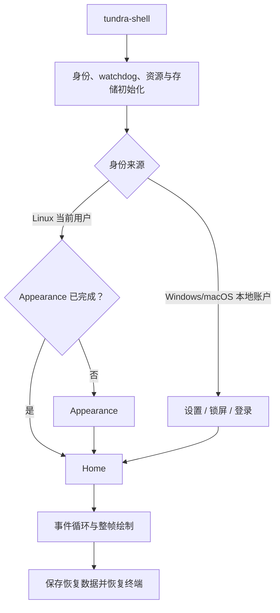
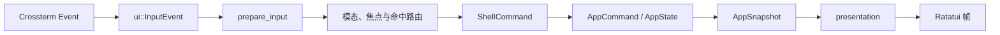

# Shell 会话、导航与绘制

本文说明 `tundra-shell` 的启动、输入、页面生命周期和整帧合成。通用视觉与交互规则见 [UI 要求](../../../docs/UI-requirements.md)。

## 启动顺序

1. Linux 校验真实/有效 UID 和 GID，root 启动需要交互确认，然后通过 NSS 解析当前用户。
2. 创建 watchdog、终端紧急恢复和进程监督，检查上次运行状态。
3. 加载默认资源并计算最小终端尺寸。
4. `prepare_shell_startup` 初始化平台权限、存储、迁移和恢复信息。
5. 播放启动画面，按需预取天气。
6. Linux 按当前 UID 的设置完成标记进入 Appearance 或 Home；Windows/macOS 进入本地账户设置、锁屏或登录。
7. 创建包含 `AppState` 和 `UiSessionState` 的 `ShellSession`，建立首屏、焦点和命中表。
8. 事件循环读取输入与后台结果，更新状态，构造 ViewModel 并绘制。

`tundra-shell --help` 和 `--version` 只输出查询结果，不进入全屏会话。

## 输入与事件循环

`src/input/` 将 Crossterm 事件规范化为 `ui::InputEvent`。键盘保留 Press、Repeat、Release 和修饰键，鼠标保留移动、按下、释放、拖动和滚动，同时处理粘贴、焦点和窗口尺寸。

输入依次经过：

- `controller/input/preparation.rs` 统一真实事件和测试的预处理路径。
- `interaction.rs` 保存输入方式、指针位置、按钮捕获和快捷键重复保护。
- `pointer.rs` 核对页面实例、弹层和布局区域，确保按下与松开属于同一目标。
- 命中层级为 `AppContent < AppOverlay < ShellChrome < ShellModal`，上层消费后不传到背景。
- 主循环每批最多处理 4,096 个事件，合并连续鼠标移动和 resize；后台结果通过 `mpsc` 在 Tick 中处理。
- 后台线程不直接修改焦点、命中表或 Ratatui 帧。

Unix 输入由本地 Crossterm 补丁组装报文。独立 Esc 等待最多 50ms，普通报文使用 250ms 空闲超时和 4,096 字节上限，括号粘贴使用 5 秒和 1 MiB 上限。错误日志只记录类型和字节数，不记录原始输入。

## 页面实例与后台任务

`ShellSession { app, ui }` 持有共享服务和全部页面实例。`PageInstanceId` 标识一次打开，`page_state.rs` 与 `AppPageModels` 按相同编号保存页面数据、选择、滚动、表单、弹窗和焦点。

`navigation.rs` 保存实际打开路径。覆盖页面保留原实例，返回时恢复；关闭后重新打开创建新实例。任务列表可返回仍存在的原页面，原页面已关闭时只打开对应功能。

`page_lifecycle.rs` 统一处理离开检查、任务选择、资源清理和返回：

- **继续后台运行：**页面销毁，结果通过通知和 AA 展示。
- **取消任务并关闭：**等待任务停止和清理完成后销毁页面。
- **留在页面：**保留页面、数据和任务。

`tasks.rs` 登记任务所属页面或会话、请求编号、代次和取消动作。旧登录会话、已关闭页面和被替代请求的结果不会更新新页面。watchdog 负责执行与异常隔离，Shell 负责归属和展示。

退出或注销前保存编辑器恢复记录，停止当前会话任务并撤销授权。任务摘要和输出跨程序重启保存，定时任务由系统服务独立执行。

## 弹窗与焦点

`session/overlays.rs` 汇总页面弹窗、菜单、通知、退出确认和 AA。输入、命中、焦点与动画读取同一份层级描述。

`ShellOverlayManager` 保存每层打开前的焦点，关闭后恢复下一层。弹窗变化清除旧按下和拖动记录，Toast 只显示消息。后台 AA 请求自动显示并接管输入，但不改变其他页面的逻辑状态。

## 帧合成

presentation 从 `AppSnapshot` 和必要的会话状态组装 ViewModel。`ScreenCompositor` 负责最终绘制，不在绘制阶段决定业务状态或返回目标。

每帧共用 `ShellFrameLayout`：顶部标题栏、中间 `main`、底部状态栏和时间按钮。布局同时用于绘制、鼠标命中、PTY 尺寸和效果边界。窗口低于最小尺寸时暂停页面输入并保留状态，放大后继续。

合成顺序：

1. 页面内容；
2. 页面弹层；
3. Shell 标题栏、状态栏和 Toast；
4. Shell 模态弹窗；
5. 当前帧动画与效果。

右上角返回按钮与 Esc 使用相同返回规则。Command Line 有运行进程时先确认是否终止，无进程时直接返回；其子终端仍接收物理 Esc 和 Ctrl+Shift+X。

状态消息区域可点击打开完整文本，弹窗保留点击时的内容并支持滚动。时钟按钮独立处理。

## 退出、休眠与异常

| 请求 | 行为 |
| --- | --- |
| 退出 | 保存恢复数据、收尾任务并恢复终端 |
| 程序重启 | Unix 使用 `exec`；Windows 等待新进程并传回退出码 |
| 重置 | 收尾后重建初始存储并重启 |
| 注销 | Windows/macOS 销毁 UI 会话并回到锁屏 |
| 电脑重启/关机 | 保存恢复数据、恢复终端后调用平台接口 |

休眠前保存编辑器恢复数据并退出全屏，恢复后重新建立终端、平台会话和尺寸。

Shell 或受监督后台任务发生 panic 时，先恢复终端并保存事故报告，再显示独立 panic 页面。R 重启，Q、Esc 或 Ctrl+C 退出，方向键和滚轮阅读长错误。

## 常用快捷键

页面按钮显示对应快捷键，F1 打开当前页完整帮助。

| 页面 | 常用输入 |
| --- | --- |
| 通用 | Tab/Shift+Tab 移动焦点，Enter/空格执行，Esc 返回 |
| 主页 | E/A/S/M/U 打开文件、启动器、设置、状态和用户；Q/Esc 打开退出确认 |
| Launcher | Enter 打开，V 切换视图，R/F5 刷新，F2 整理 |
| 文件管理 | S、Ctrl+F 或 `/` 搜索，F5 刷新，F6 排序 |
| 管理页 | S 搜索，R/F5 刷新，F4 详情，Ctrl+Enter 提交 |
| 日志 | O/Enter 打开，L/M/T 筛选，C 清除，G 打开日志目录 |
| 系统状态 | E 编辑，A 添加，F4 尺寸，Ctrl+S 保存布局 |
| 时钟 | N 新建，M 管理 |
| 登录 | Enter 登录，F2 显示或隐藏密码 |

文字输入中的字母正常写入，不触发页面字母快捷键。

## AA 与命令行的屏幕键盘

屏幕键盘入口由合成器放在右下角，覆盖 AA、命令行、管理输入、登录、首次设置、账户、设置、编辑器、文件路径和搜索等文字输入。

- 虚拟按键和粘贴进入当前页面或子终端的正常输入流程。
- Ctrl、Alt、Shift 和 CapsLock 可点按锁定，组合键继续交给当前程序。
- 普通页面展开后收起标题栏和底栏，为页面与表单留出空间；AA 只移动顶层弹窗。
- 键盘归属绑定页面实例和表单编号，切换页面、任务或弹窗后清除旧输入状态。
- 窗口空间不足时保留表单和操作按钮，并提示扩大窗口。
- 键盘文字来自语言包，布局、绘制和点击共用当前动画帧的位置。

独立演示使用 `tundra-cli debug screen-keyboard`，见[调试预览](previews.md#屏幕键盘)。

## 外部输入

启用 `automation.enabled` 后，`session/automation.rs` 在 Shell 线程处理本机连接。点击、拖动、滚动、按键和文字先转换为 Crossterm 事件，再进入正常输入流程，不直接执行页面命令。

合成器从实际布局和最终帧采集控件与文字，绘制成功后发布快照。真实用户操作会使旧快照失效，超时的输入不会重放。协议与命令见[外部 CLI 控制](../../cli/docs/ui-control.md)。
