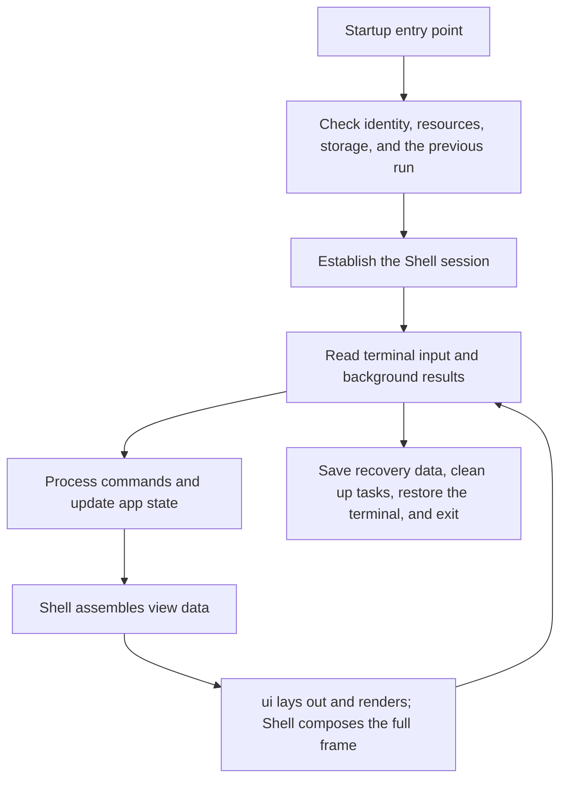
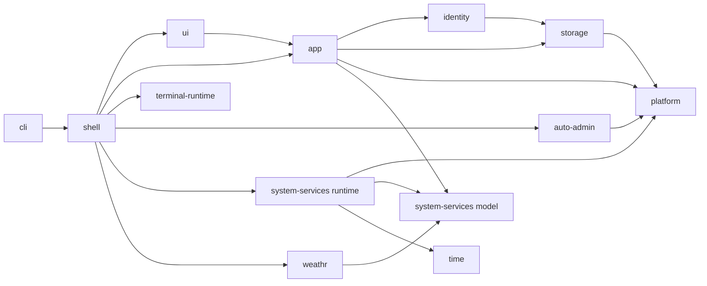

# TundraUX3 technical documentation

This document covers the project architecture, building, testing, and packaging. See the [Chinese README](README.zh-CN.md) for installation and interface controls, and each crate's documentation for module implementation details.

## Building and running

The project uses Rust edition 2024 and requires **Rust 1.95** or newer. From the repository root, run:

```sh
cargo build --locked -p shell -p cli
python3 scripts/build-vim.py --output target/debug/vim
cargo run --locked -p shell --bin tundra-shell
cargo run --locked -p cli --bin tundra-cli -- doctor
```

Build both Shell and CLI after updating the source so that the built-in command line uses the matching version of `tundra-cli`. Add `--release` to the commands above for release builds.

The Vim build script downloads the pinned upstream source and places the engine and runtime beside Shell. Ordinary Cargo builds do not download Vim. See [bundled Vim](packaging/vim.md) for build dependencies, offline sources, and release procedures for all three platforms.

Home and the built-in Command Line share a minimum of **108 × 20** terminal cells. Home uses names only when complete icons do not fit, keeping every entry on one page at this size. Mouse and touch input is forwarded by the host terminal.

## Application architecture

Shell manages terminal sessions, pages, and input; App stores application state; UI handles layout and rendering; Platform provides operating-system interfaces; CLI provides external commands and diagnostics.



Linux uses the system user that launches the program and opens the home page after the initial language and appearance setup. Windows and macOS use local accounts, login, and lockscreen flows. See the [session guide](../crates/shell/docs/session.md) for detailed rules.

## Crate responsibilities

| Crate | Responsibilities |
| --- | --- |
| [shell](../crates/shell/README.md) | Pages, focus, input routing, dialogs, event loop, and full-frame composition |
| [cli](../crates/cli/README.md) | External commands, REPL, diagnostics, and internal helper entry points |
| [app](../crates/app/README.md) | Application state, commands, file workflows, clock scheduling, and updates |
| [ui](../crates/ui/README.md) | View data models, layouts, rendering, and shared controls |
| [terminal-runtime](../crates/terminal-runtime/README.md) | Host terminal modes, child terminals, input encoding, and terminal snapshots |
| [vim-runtime](../crates/vim-runtime/README.md) | Vim processes, buffer synchronization, controlled saves, and terminal snapshots |
| [auto-admin](../crates/auto-admin/README.md) | Operation approval, password input, task finalization, and authorization connections |
| [platform](../crates/platform/README.md) | Operating-system paths, files, processes, and system-management interfaces |
| [storage](../crates/storage/README.md) | Application documents, format validation, atomic saves, migration, and corruption recovery |
| [identity](../crates/identity/README.md) | The current Linux user and local Windows/macOS accounts |
| [system-services](../crates/system-services/README.md) | Shared system and weather snapshots, and optional background services |
| [time](../crates/time/README.md) | HTTP time synchronization, time advancement, and timezone conversion |
| [weathr](../crates/weathr/README.md) | Weather scenes and lockscreen views |
| [ascii-assets](../crates/ascii-assets/README.md) | Distribution, validation, and repair of themes, patterns, icons, and fonts |
| [i18n](../crates/i18n/README.md) | Language catalogs, message validation, fallback, and language snapshots |
| [runtime-log](../crates/runtime-log/README.md) | Runtime events, redaction, log queries, capacity, and cleanup |
| [watchdog](../crates/watchdog/README.md) | Process and task supervision, incident reports, and operation recovery records |

The main calling relationships are shown below. Each crate's `Cargo.toml` is authoritative for the complete dependencies:



## Module conventions

| Area | Convention |
| --- | --- |
| Application and interface | `app` is independent of UI, Ratatui, and crossterm; commands express application semantics without passing coordinates, component IDs, or raw keys |
| Rendering | Shell assembles the ViewModel; pages render `ShellFrameLayout.main`, while the final compositor places global bars and dialogs |
| Terminal | Shell manages the lifecycle; `terminal-runtime` enters and restores terminal modes; UI does not modify the host terminal directly |
| System and storage | System interfaces go through `platform`; application documents go through `storage`; system configuration files use authorization checks and backup workflows |
| Background work | watchdog manages tasks and declares whether they can be safely replayed; AA handles approval, while the operating system handles system permissions |
| Text | The editor moves by complete user-visible characters, not UTF-8 byte offsets as cursor positions |
| Resources | Images provide an ASCII fallback; languages and themes are managed independently |

See [UI requirements](UI-requirements.md) for the shared acceptance criteria for interface development. Security, authorization, and recovery details are in the relevant crate documentation.

## Validation

Run the full checks from the repository root:

```sh
cargo fmt --check
cargo test --workspace --locked
cargo build --locked -p shell -p cli
python3 scripts/check-localization.py
bash scripts/check-weathr-dependency-boundary.sh
```

For targeted changes, run `cargo test --locked -p <package>`. Run Linux checks in local WSL or a Linux environment; Windows uses the MSVC toolchain, for example:

```sh
cargo +stable-x86_64-pc-windows-msvc test --workspace --locked
```

When resources are limited, set `CARGO_BUILD_JOBS=2 CARGO_INCREMENTAL=0`, or use `CARGO_PROFILE_TEST_DEBUG=0` to reduce test artifact size. The regular test suite does not make HTTP requests or start HTTP test servers; add `--offline` when dependencies are cached.

Real terminals, touchscreens, system authorization, and device write operations require separate acceptance checks on the corresponding platform. See the [testing guide](testing.md) for test directories, PTY, root startup, and CI details.

## Linux packaging

```sh
python3 scripts/build-vim.py --output target/release/vim
bash scripts/package-linux.sh
```

The packaging script runs on Linux x86_64, builds release versions of Shell and CLI, and writes to `dist/` by default. The version comes from the workspace and can be overridden with `TUNDRAUX3_VERSION`.

Releases use portable archives containing both programs, `assets/`, `vim/`, `tundra-installation.json`, licenses, runtime notes, and `SHA256SUMS`. Keep these files together when running the application. See the [app update guide](../crates/app/docs/update.md) for update and recovery workflows.

## Third-party components

Dependencies are based on official releases. The repository uses locally maintained dependency versions through `[patch.crates-io]`; when changing patches, also check the relevant tests and licenses:

- [crossterm patch](../third_party/crossterm/TUNDRA_PATCH.md): message boundaries, timeouts, input limits, and warnings.
- [vt100 patch](../third_party/vt100/TUNDRA_PATCH.md): terminal scrollback and `CSI 3 J`.
- [OpenCode UI reference](../third_party/opencode/README.md): loading-text sweep curves adapted under MIT; release archives include `LICENSE.opencode`.

Project code uses [GPL-3.0-only](../LICENSE), and Weathr uses [GPL-3.0-or-later](../crates/weathr/LICENSE.weathr). See the respective documentation for licenses covering other resources and third-party code.

Bundled Vim retains the upstream Vim License and records its source and version in `vim/UPSTREAM.json`. See [bundled Vim](packaging/vim.md).

## Troubleshooting

| Symptom | Action |
| --- | --- |
| Terminal too small | Enlarge the window as prompted; custom resources may change the minimum size |
| Command Line appears to be an old version | Rebuild both Shell and CLI, and ensure both come from the same debug/release directory |
| Paths, permissions, or system features fail | Run `tundra-cli doctor` and `tundra-cli debug paths` to check the specific dependencies and permissions |
| Terminal display is incorrect after an abnormal exit | Reset the current terminal, then check the `crashes` reports in the log directory and the next-startup prompts |
| Configuration or state is corrupted | Back up the reported paths first, then follow the recovery prompts; `tundra-cli new` clears the data |
| Graphical opening or clipboard access is unavailable on Linux | Check `xdg-utils`, gio, D-Bus/portal, and the terminal session |
