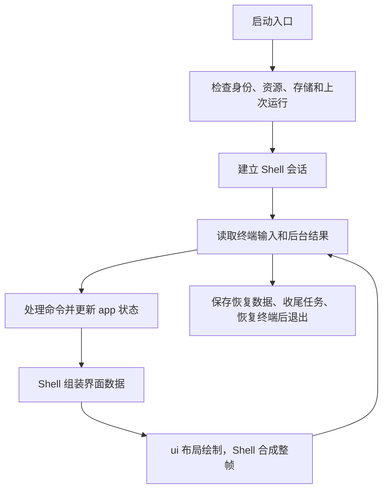
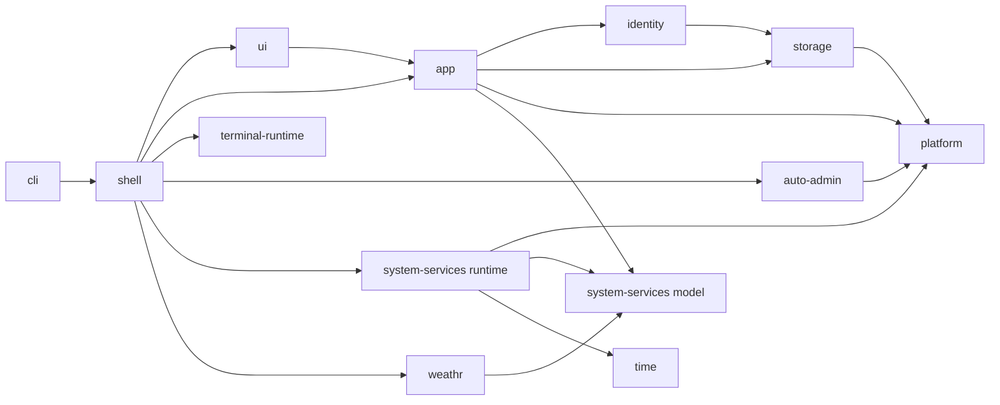

# TundraUX3 技术文档

本文介绍项目架构、构建、测试和打包。安装与界面操作见[中文 README](README.zh-CN.md)，各模块的实现细节见所属 crate 的文档。

## 构建和运行

项目使用 Rust 2024 edition，最低支持 **Rust 1.95**。在仓库根目录执行：

```sh
cargo build --locked -p shell -p cli
python3 scripts/build-vim.py --output target/debug/vim
cargo run --locked -p shell --bin tundra-shell
cargo run --locked -p cli --bin tundra-cli -- doctor
```

更新源码后同时构建 Shell 和 CLI，确保内置命令行使用同版本的 `tundra-cli`。发布构建在上述命令中添加 `--release`。

Vim 构建脚本下载固定版本的上游源码，并将引擎和 runtime 放到 Shell 旁。普通 Cargo 构建不会下载 Vim。构建依赖、离线源码和三平台发布方法见[随包 Vim](packaging/vim.md)。

默认界面需要至少 **108 × 20** 个终端单元格，内置 Command Line 需要更多垂直空间。鼠标和触摸输入由宿主终端转发。

## 程序架构

Shell 管理终端会话、页面和输入，App 保存应用状态，UI 负责布局与绘制，Platform 提供操作系统接口，CLI 提供外部命令和诊断入口。



Linux 使用启动程序的系统用户，首次启动完成语言和外观设置后进入主页。Windows 和 macOS 使用本地账户、登录与锁屏流程。详细规则见[会话说明](../crates/shell/docs/session.md)。

## Crate 分工

| Crate | 职责 |
| --- | --- |
| [shell](../crates/shell/README.md) | 页面、焦点、输入路由、弹窗、事件循环和整帧合成 |
| [cli](../crates/cli/README.md) | 外部命令、REPL、诊断和内部助手入口 |
| [app](../crates/app/README.md) | 应用状态、命令、文件工作流、时钟调度和更新 |
| [ui](../crates/ui/README.md) | 界面数据模型、布局、绘制和通用控件 |
| [terminal-runtime](../crates/terminal-runtime/README.md) | 宿主终端模式、子终端、输入编码和终端快照 |
| [vim-runtime](../crates/vim-runtime/README.md) | Vim 进程、缓冲同步、受控保存和终端快照 |
| [auto-admin](../crates/auto-admin/README.md) | 操作批准、密码输入、任务收尾和授权连接 |
| [platform](../crates/platform/README.md) | 操作系统路径、文件、进程和系统管理接口 |
| [storage](../crates/storage/README.md) | 应用文档、格式校验、原子保存、迁移和损坏恢复 |
| [identity](../crates/identity/README.md) | Linux 当前用户及 Windows/macOS 本地账户 |
| [system-services](../crates/system-services/README.md) | 共享系统、天气快照和可选后台服务 |
| [time](../crates/time/README.md) | HTTP 时间同步、时间推进和时区转换 |
| [weathr](../crates/weathr/README.md) | 天气场景和锁屏画面 |
| [ascii-assets](../crates/ascii-assets/README.md) | 主题、图案、图标和字体的分发、校验与修复 |
| [i18n](../crates/i18n/README.md) | 语言目录、消息校验、回退和语言快照 |
| [runtime-log](../crates/runtime-log/README.md) | 运行事件、脱敏、日志查询、容量和清理 |
| [watchdog](../crates/watchdog/README.md) | 进程和任务监督、事故报告与操作恢复记录 |

主要调用关系如下，完整依赖以各 crate 的 `Cargo.toml` 为准：



## 模块约定

| 范围 | 约定 |
| --- | --- |
| 应用与界面 | `app` 独立于 UI、Ratatui 和 crossterm；命令使用应用语义，不传递坐标、组件 ID 或原始按键 |
| 绘制 | Shell 组装 ViewModel；页面绘制 `ShellFrameLayout.main`，全局栏和弹窗由最终合成器安排 |
| 终端 | Shell 管理生命周期，`terminal-runtime` 进入和恢复终端，UI 不直接修改宿主终端 |
| 系统和存储 | 系统接口通过 `platform`；应用文档通过 `storage`；系统配置文件使用授权检查和备份流程 |
| 后台工作 | watchdog 管理任务并声明能否安全重放；AA 负责批准，系统权限由操作系统处理 |
| 文本 | 编辑器按用户可见的完整字符移动，不使用 UTF-8 字节偏移作为光标位置 |
| 资源 | 图片提供 ASCII 回退；语言和主题独立管理 |

界面开发的共同验收标准见 [UI 要求](UI-requirements.md)。安全、授权和恢复细节放在对应 crate 的文档中。

## 验证

在仓库根目录运行完整检查：

```sh
cargo fmt --check
cargo test --workspace --locked
cargo build --locked -p shell -p cli
python3 scripts/check-localization.py
bash scripts/check-weathr-dependency-boundary.sh
```

定向改动可运行 `cargo test --locked -p <包名>`。Linux 相关检查在本机 WSL 或 Linux 环境执行；Windows 使用 MSVC 工具链，例如：

```sh
cargo +stable-x86_64-pc-windows-msvc test --workspace --locked
```

资源有限时，可设置 `CARGO_BUILD_JOBS=2 CARGO_INCREMENTAL=0`，或使用 `CARGO_PROFILE_TEST_DEBUG=0` 减少测试文件占用。固定测试不发起 HTTP 请求或启动 HTTP 测试服务器，依赖已缓存时可添加 `--offline`。

真实终端、触屏、系统授权和设备写操作需要在对应平台单独验收。测试目录、PTY、root 启动和 CI 说明见[测试指南](testing.md)。

## Linux 打包

```sh
python3 scripts/build-vim.py --output target/release/vim
bash scripts/package-linux.sh
```

打包脚本在 Linux x86_64 上运行，构建 Shell 与 CLI 的 release 版本，默认输出到 `dist/`。版本号来自 workspace，也可通过 `TUNDRAUX3_VERSION` 指定。

发行格式为便携包，包含两个程序、`assets/`、`vim/`、`tundra-installation.json`、许可证、运行说明和 `SHA256SUMS`。使用时保持这些文件在一起。更新与恢复流程见 [app 更新说明](../crates/app/docs/update.md)。

## 第三方组件

依赖以正式发布版为基线。仓库通过 `[patch.crates-io]` 使用本地维护的依赖版本，修改补丁时同步检查相关测试与许可：

- [crossterm 补丁](../third_party/crossterm/TUNDRA_PATCH.md)：报文边界、超时、输入限制和警告。
- [vt100 补丁](../third_party/vt100/TUNDRA_PATCH.md)：终端滚动历史和 `CSI 3 J`。

项目代码使用 [GPL-3.0-only](../LICENSE)，Weathr 使用 [GPL-3.0-or-later](../crates/weathr/LICENSE.weathr)。其他资源和第三方代码的许可见各自说明。

随包 Vim 保留上游 Vim License，并在 `vim/UPSTREAM.json` 中记录来源和版本，详见[随包 Vim](packaging/vim.md)。

## 故障排查

| 现象 | 处理方法 |
| --- | --- |
| 终端太小 | 按提示放大窗口；自定义资源可能改变最低尺寸 |
| Command Line 像是旧版本 | 同时重新构建 Shell 和 CLI，并确保两者来自同一 debug/release 目录 |
| 路径、权限或系统功能失败 | 运行 `tundra-cli doctor` 和 `tundra-cli debug paths`，检查具体依赖和权限 |
| 异常退出后终端显示不正常 | 重置当前终端，查看日志目录中的 `crashes` 报告和下次启动提示 |
| 配置或状态损坏 | 先备份报告中的路径，再按恢复提示处理；`tundra-cli new` 会清空数据 |
| Linux 图形打开或剪贴板不可用 | 检查 `xdg-utils`、gio、D-Bus/portal 和终端会话 |
