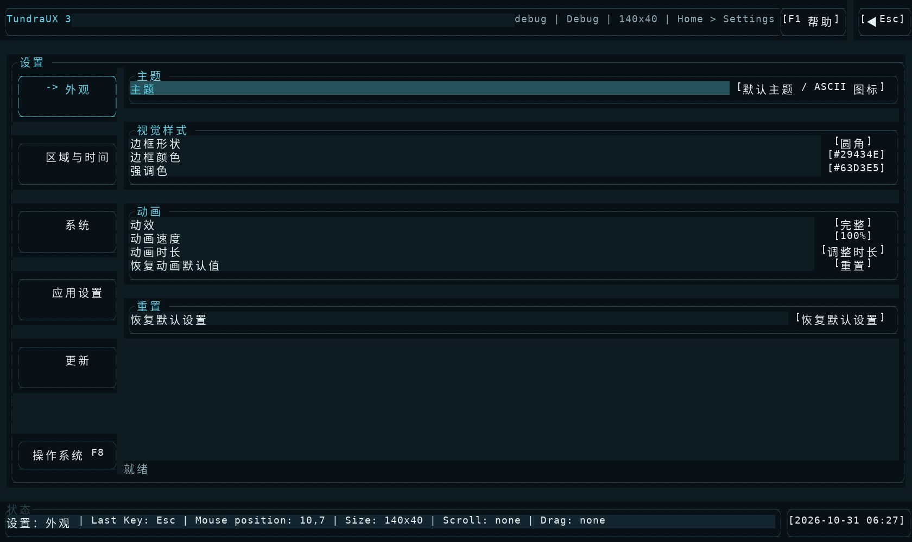
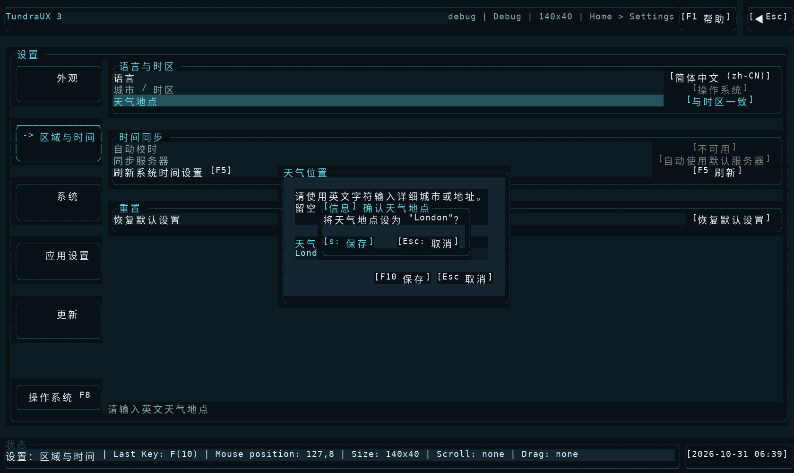
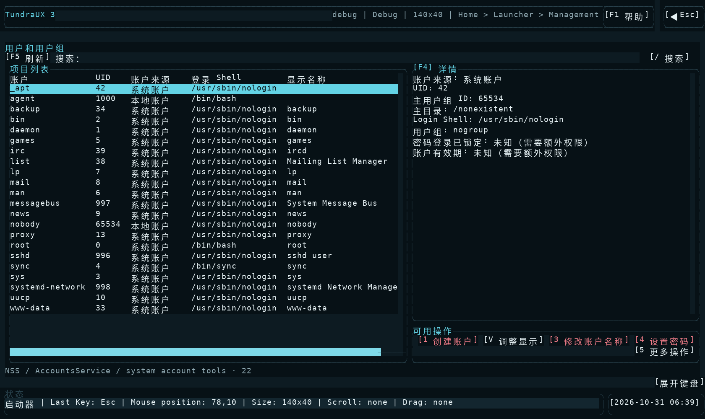
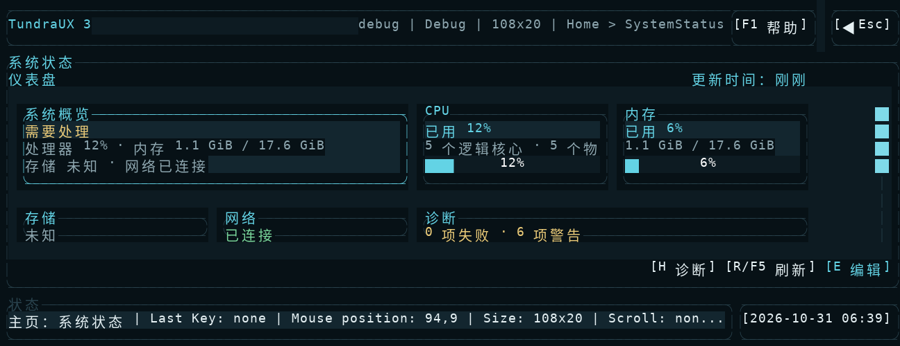

# 2026-10-31 界面与操作验收

本次在 Linux 实际运行 Shell，使用项目自己的 `tundra-cli ui` 操作和读取界面。完成主页面、主要弹窗与最小尺寸检查，并修正冗长文案、按钮含义和布局问题。

## 环境与证据

- Debian 13，Linux 6.18，普通用户；构建 Shell 和配套 CLI，使用独立 XDG 目录和真实 PTY。
- 中文界面，终端尺寸 140×40、108×20；英文标签另由界面测试覆盖，包括 30×10 和 50×12 的时钟弹窗。
- 修改后保留 76 组画面，修改前保留 31 组记录。每组有 PNG、原生字符快照、完整控件 JSON 和按钮／输入控件清单。
- 完整证据包 `tundra-ui-review.zip` 随任务交付；解压后打开 `index.html`，可逐页查看截图、控件 ID、名称、区域、启用及可操作状态。`buttons.csv` 可用于筛选按钮，`logs/` 保留测试输出。
- 修改后 PNG 从实际 PTY 的 ANSI 输出还原；修改前 PNG 由原生字符快照等宽绘制，不保留原配色。原生 `ui snapshot` 本身没有图像像素；PNG 是终端记录的可视化。

## 覆盖画面

| 范围 | 画面与流程 |
| --- | --- |
| 启动与导航 | 首次设置、主页、帮助、文件管理、启动器两屏、退出确认 |
| 内置应用 | 服务、进程、软件包、网络、磁盘、防火墙、SSH、备份、定时任务、任务中心、日志、用户、编辑器、脚本编辑器、命令行 |
| 软件包 | 已安装、搜索、更新及帮助；实际包列表多选 |
| 设置 | 外观、区域与时间、系统、应用、更新；动画时长、数值、AA 策略、超时、编辑器、天气输入与确认、操作系统入口 |
| 系统状态 | 仪表盘、概览、CPU、内存、存储、网络、诊断、运行时间与负载 |
| 其他弹窗 | 时钟、新建闹钟／倒计时、屏幕键盘、账户创建、更多操作、进程确认、AutoAdmin 结果 |
| 最小尺寸 | 主页、文件管理、设置与数值弹窗、软件包、网络、备份、任务、编辑器、脚本、日志、用户、系统状态、时钟及新建弹窗 |

所有保存的快照均检查了控件 ID 唯一、区域未越界、禁用控件不可操作。对新增修改重点复查按钮文字、遮挡、返回与取消、空状态和小窗口裁切。

## 发现与修改

| 原问题 | 修改后的行为 |
| --- | --- |
| 天气保存确认叠加匹配不准确等说明，并显示“警告” | 只确认地点，使用普通提示；保存、取消按钮明确可见 |
| 授权、备份、服务错误与更新失败堆放通用说明，部分内容重复 | 保留当前状态、具体原因及必要后果；删去泛泛的保证或免责式文字；定时任务的完整规则移入 F1 |
| 动画入口叫“高级选项／打开”，时钟操作只有名词 | 改为“动画时长／调整时长”“创建闹钟／创建倒计时”；明确“操作系统 F8”入口 |
| 管理按钮快捷键出现重复方括号 | 快捷键和动作只显示一组按钮边界 |
| 设置外观页另放解释式预览 | 直接展示实际设置控件，减少占用和说明文字 |
| 管理空列表把多行原因拼在一行 | 按原换行及可用宽度绘制；完整错误仍可查看 |
| 数值弹窗计算区域和实际绘制使用不同按钮文案 | 统一使用“保存／取消”，使输入、加减与点击区域一致 |
| 108×20 时仪表盘卡片标题被数值覆盖 | 两行卡片保留标题和当前值；新增回归测试先复现再通过 |
| 账户页直接展示六个操作 | 常用操作最多五个，用户组编辑放入“更多操作”且仍可达 |
| 进程搜索测试在查询完成前点击旧列表 | 等待结果只包含两个测试进程且均可操作，再进行多选 |

中英文资源同步修改。网络页面的配置来源、只读原因和未知状态改用本地化文字，原生接口标识保持不变。未发现源码中直接写出的“不保证”字样；本次清理的是相同阅读问题的长提示和防御式措辞。

## 修改后示例

外观设置直接展示可操作项目：



天气地点确认只保留当前决定：



账户页最多五个常用操作：



108×20 时，存储、网络和诊断卡片仍能直接辨认：



## 验证结果

| 检查 | 结果 |
| --- | --- |
| `cargo build --locked -p shell -p cli` | 通过 |
| `python3 scripts/check-localization.py` | 3,840 处调用、4,138 对中英文消息通过 |
| `cargo test --locked -p ui` | 404 项通过 |
| Shell 管理、设置、automation 定向测试 | 91 + 26 + 14 项通过 |
| Platform 网络、定时任务、软件包查询定向测试 | 31 + 17 + 9 项通过；4 项原有环境集成测试忽略 |
| `python3 scripts/tests/shell-control.py` | 最终构建的 11 组流程全部通过 |
| 原生 UI 补验 | 数值加号按动画速度步长从 100 调至 125，取消后放弃；账户五按钮及更多菜单；小卡片标题；天气确认；测试进程与 AA 结果通过 |

端到端脚本覆盖首次设置、真实多选事件、两个自建进程的暂停与继续、快照有效性、天气唤醒、UTF-8 编辑保存、拖动、滚动、弹窗阻挡、终端缩放、内嵌命令行及关闭外部控制。沙箱最初阻止本地 socket；允许本地测试所需权限后，相关测试通过。

复现定向测试：

```sh
cargo test --locked -p shell --lib session::controller::management::tests
cargo test --locked -p shell --lib session::controller::settings
cargo test --locked -p shell --lib session::automation::tests
cargo test --locked -p platform --lib management::network
cargo test --locked -p platform --lib management::scheduled_tasks
cargo test --locked -p platform --lib management::packages::query::tests
```

## 本次环境未覆盖

当前 PID 1 不是 systemd，部分设备和服务不存在；对应页面验证不可用状态、详情与返回流程。没有执行真实软件安装、系统服务变更、网络配置写入或创建系统账户。物理鼠标／触屏、其他操作系统，以及非 Linux 身份后端的登录和初始化账户页面未作实机验收；Linux 账户入口已验证实际系统账户页面。完整生产环境与物理触屏验收仍按 [UI 要求](UI-requirements.md) 单独执行。
